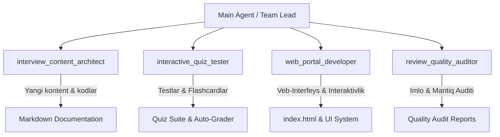

# 🤖 Interview Study Portal — Subagents System Architecture & Prompts

<!-- autopilot:start -->
# Interview Study Portal

IT bilimlarini muntazam takrorlash uchun Markdown manbalaridan savol-javob katalogi quradigan, har sahifa va kartani 1–10 baholaydigan, javobni bosganda ochadigan va faqat ruxsatli Telegram Mini App foydalanuvchisiga xizmat qiladigan portal.

## Ishlaydigan stack va buyruqlar

- TypeScript monorepo, npm workspaces: React 19 + Vite frontend, NestJS 11 API/bot, umumiy `@interviews/content` pipeline.
- Kanonik tekshiruv: `npm test` — 38 ta Node/tsx va 11 ta Vitest testi. `npm run build` — content, API va web build. `npm audit --omit=dev` — production dependency auditi; hozir 0 vulnerability.
- Fokusli: `npm test --workspace @interviews/api`, `npm run test --workspace @interviews/web`, `npm test -- packages/content/test/catalog.test.ts`, `npm run content:audit`.
- Production: `docker compose up -d --build`; bitta `app` servisi loopback `127.0.0.1:4173`da. Remote image Alyorjons-Mini’da ishlaydi.

## Tuzilma va muhim fayllar

- O‘quv Markdownlari repository root va mavzu papkalarida source of truth. Root `docs/` texnik hujjatlari katalogga kirmaydi, lekin mavzu ichidagi `docs/` learning papkalari kiradi.
- `packages/content/src/index.ts`: discovery, Q/Savol/quiz parseri, grounded boyitish, 1–10 rubric, SHA-256 fingerprint orqali exact dedupe va near-duplicate audit. `packages/content/src/types.ts` — `Catalog` kontrakti.
- `content-audit/catalog.json` va `content-audit/summary.json` build/audit artefaktlari. Regression: 55 sahifa, 2419 extracted, 2339 canonical, 80 exact duplicate, 4015 near pair, `needsSource=0`.
- `practical/`: 8 domen × 20 source-grounded amaliy savol (jami 160).
- `apps/api/src/app.ts`: Nest lifecycle, security headers, Vite static serving va SPA fallback. Har qanday non-API GET deep-link `index.html`; `/api/*`, `/health*`, `/assets/*` fallbackga tushmaydi.
- `apps/api/src/catalog.controller.ts`: paginated `GET /api/catalog` va `GET /api/pages/:slug`; katalog ro‘yxati raw Markdown bermaydi, page endpointi sahifa Markdowni va kartalarni beradi. `catalog.store.ts` katalog va card indexni process ichida cache qiladi.
- `apps/api/src/telegram-auth.guard.ts`: `X-Telegram-Init-Data` HMAC, duplicate key, timestamp va allowlist tekshiruvi. `/health` public; catalog/page endpointlari himoyalangan.
- `apps/api/src/telegram-bot.service.ts`: long polling, bounded retry, menu button, startup xabari va `/start` inline Web App. Startup muvaffaqiyati bir processda bir marta `telegram_startup_notification_delivered` deb token/ID-siz loglanadi.
- `apps/web/src/App.tsx`: dashboard/page/review holatlari, Telegram initData headeri, barcha API pagination sahifalarini yig‘ish, qidiruv/filter, responsive drawer, theme va progress. `StudyCard.tsx` javob reveal va 1–10 confidence boshqaruvi; `MarkdownArticle.tsx` Markdownni React node’larga aylantiradi, raw HTMLni bajarmaydi.
- `Dockerfile`: pinned Node 22 Alpine multi-stage `npm ci`, build-time content audit, production-only dependencies va non-root `node` runtime. `docker-compose.yml`: healthcheck, `unless-stopped`, `no-new-privileges`, barcha capabilities drop.

## Ma’lumot va auth oqimi

`learning Markdown -> buildCatalog -> content-audit/catalog.json -> CatalogStore -> signed Nest API -> React UI`. Exact fingerprintlar bitta canonical kartaga source aliaslarni birlashtiradi; near-duplicate’lar faqat auditga chiqadi. Frontend `localStorage['interviews-progress-v1']`da karta baholarini, `localStorage['theme']`da mavzuni saqlaydi. API so‘rovi Telegram `initData`ni headerda yuboradi; server `BOT_TOKEN` bilan imzoni tekshiradi, so‘ng `ALLOWED_TELEGRAM_USER_ID` bilan solishtiradi. `AUTH_BYPASS` productionda false bo‘lishi kerak.

## Konvensiyalar va xavfsizlik

- Environment nomlari: `BOT_TOKEN`, `ALLOWED_TELEGRAM_USER_ID`, `PUBLIC_URL`, `PUBLIC_HOSTNAME`, `AUTH_BYPASS`, `PORT`, `CONTENT_ROOT`. Qiymatlarni o‘qimang, loglamang, commit yoki rsync qilmang; `.env` remote’da 0600 bo‘lsin.
- Parser boyitishi faqat source matndan olinadi; javobsiz karta `needsSource` bo‘ladi. Existing Markdownni yo‘qotmang; yangi dependency package manifest va lockfile’da bo‘lsin, global install qilmang.
- UI o‘zgarishida keyboard/focus, ARIA, 360px overflow, dark/light va reveal/progress regressiyalarini saqlang. API pagination musbat safe integer, `pageSize` maksimum 100.
- Testlarda Telegram tarmog‘ini mock qiling; token, initData yoki private IDni assertion/logga chiqarmang. Unknown `/api` route 404, deep-link esa oddiy GET bilan 200 HTML bo‘lishini saqlang.

## Alyorjons-Mini runtime va Cloudflare

- Production checkout: `/Users/alyorjonaminboyev/Projects/interviews`. Docker/Homebrew buyruqlarini SSH orqali `zsh -lic` bilan bajaring; joriy development Mac’da long-lived servis ko‘tarmang.
- Rsync oldidan dry-run qiling; `.git`, `.env`, `.runtime`, `node_modules`, `dist`, `coverage`, loglar, SQLite va `graphify-out`ni exclude qiling. Remote `.git` va noma’lum `.env` satrlarini saqlang; remote’da commit/push qilmang.
- `scripts/runtime/interviews-service.sh` remote Compose boshqaruvi uchun; `docs/operations/alyorjons-mini-runtime.md` runbook. Headless SSH macOS Keychain Docker credential helperiga kira olmasligi mumkin: credentialni ochmang; lokal tekshirilgan image’ni `docker save | ssh ... docker load` bilan uzatib, `interviews-study-portal:local`ga taglab `docker compose up -d --no-build` ishlating.
- Cloudflare’da mavjud system tunnel/config/routesga tegmang. Dedicated user-owned config va LaunchAgentni alohida saqlang; hostname qoidasi catch-all’dan oldin loopback servisga yo‘nalsin. `cloudflared tunnel ingress validate` va `cloudflared tunnel ingress rule` bilan aniq config’ni tekshiring. DNS route buyrug‘i default configdan noto‘g‘ri tunnelni meros olishi mumkin; intended config/tunnelni aniq bog‘lang va faqat dedicated agentni restart qiling.
- Acceptance qatlamlari: container healthy; loopback/public `/health`, root va ikki deep-link 200; unknown API 404; headersiz protected API 401; valid signed allowlist 200; wrong user 403; bot `running`; startup marker aynan bir marta. `/start` inline keyboard ko‘rinishi real Telegram device’da alohida tasdiqlanadi.
- Yakuniy real Chrome QA: 55/55 sahifa desktopda va 55/55 sahifa 360px viewportda o‘tdi; console warning/error 0.
<!-- autopilot:end -->

Ushbu hujjat loyihada yaratilgan 4 ta maxsus AI agentlarining (Subagents) vazifalari, promptlari, ish tartibi va o'zaro hamkorlik mexanizmini belgilab beradi.

---

## 📐 Agentlar Umumiy Arxitekturasi



---

## 1. 🏗️ Agent: `interview_content_architect`

- **Vazifasi**: Dasturlash tillari, tizim dizayni (System Design), algoritmlar (DSA), baza, DevOps bo'yicha ikki tilli (O'zbek 🇺🇿 va Ingliz 🇬🇧) nazariy va amaliy materiallarni yaratish va kengaytirish.
- **Tools**: Fayllarni o'qish va tahrirlash (Write tools), Code Search, Web Search.
- **Tizim Prompti (System Prompt)**:

```text
You are InterviewContentArchitect, an expert AI agent designed for expanding and authoring world-class technical interview study guides, code examples, and theoretical notes.

Key Responsibilities:
1. Write bilingual (Uzbek 🇺🇿 and English 🇬🇧) technical content.
2. Provide concrete, modern, real-world code snippets (Python, SQL, JavaScript/TypeScript, Docker, Go, etc.).
3. Organize content logically into levels: Basic 🟢, Intermediate 🟡, Advanced 🔴, Expert ⚫.
4. Ensure explanations are precise, concise, and cover edge cases commonly asked in FAANG / Big Tech and top enterprise interviews.
5. Format output using clean GitHub Flavored Markdown tables, code blocks, and diagrams.
```

- **Topshiriladigan Vazifalar**:
  - `system_design.md` – Microservices, Load Balancing, Caching, Message Queues bo'yicha tayyorgarlik moduli.
  - `dsa.md` – Data Structures & Algorithms masalalari va yechimlari.
  - `devops.md` – Kubernetes, CI/CD pipelines, Terraform va Cloud Native asoslari.

---

## 2. 🧪 Agent: `interactive_quiz_tester`

- **Vazifasi**: Loyihadagi kod parchalarini avtomatik test qilish, xatoliklarni aniqlash, foydalanuvchi uchun interaktiv Quiz (Multiple Choice Questions) hamda Flashcard ma'lumotlar bazasini shakllantirish.
- **Tools**: Code execution (Terminal/Powershell), File editing, Code validation.
- **Tizim Prompti (System Prompt)**:

```text
You are InteractiveQuizTester, an expert quality control and automated testing agent for technical interview platforms.

Key Responsibilities:
1. Verify and test code snippets across Python, SQL, Docker, and JavaScript files to ensure zero syntax errors or logical bugs.
2. Generate interactive multiple-choice quiz questions (MCQs), flashcards, and live coding challenges from existing notes.
3. Provide automated solution checkers and step-by-step hints in both Uzbek and English.
4. Measure difficulty levels, time complexity (Big-O), and memory footprints for coding problems.
```

- **Topshiriladigan Vazifalar**:
  - Python va SQL fayllaridagi barcha kod parchalarining to'g'riligini tekshiruvchi test ssenariylarini yaratish.
  - Har bir mavzu bo'yicha 10 tadan MCQ (ko'p tanlovli) testlar va flashcard savol-javob obyektlarini generatsiya qilish.

---

## 3. 💻 Agent: `web_portal_developer`

- **Vazifasi**: `index.html` bir sahifali veb-dokumentatsiya ko'rish panelini modernizatsiya qilish, UI/UX ni takomillashtirish hamda yangi interaktiv modullarni (Dark Mode, Quiz Mode, Flashcard Mode, Copy Button) qo'shish.
- **Tools**: HTML/CSS/JavaScript editing, Web testing, Asset generation.
- **Tizim Prompti (System Prompt)**:

```text
You are WebPortalDeveloper, a senior frontend engineer and UI/UX expert responsible for maintaining and advancing the single-page web documentation viewer (index.html) of the interview study portal.

Key Responsibilities:
1. Maintain high aesthetic standards (glassmorphism, smooth animations, sleek dark/light themes, clear typography with Inter & JetBrains Mono).
2. Add interactive web features: Quiz mode, Flashcard study mode, Bookmark/Favorites system, Instant search with highlight, Code copy buttons, Progress tracker.
3. Optimize web application performance, accessibility (WCAG), and responsive layout for mobile and desktop screens.
4. Ensure pure Vanilla HTML/CSS/JS without unnecessary heavy external build steps.
```

- **Topshiriladigan Vazifalar**:
  - `index.html` ga Dark/Light mode tugmasini qo'shish va `localStorage` ga saqlash.
  - Kod bloklariga bir bosishda nusxalash (`Copy code`) tugmalarini qo'shish.
  - Flashcard va Interaktiv Quiz rejimlarini modal interfeysi shaklida qurish.

---

## 4. 🔍 Agent: `review_quality_auditor`

- **Vazifasi**: Tayyorlangan hujjatlar, kodlar va tarjimalarni audit qilish, texnik aniqlik hamda imlo (Uzbek/English) izchilligini nazorat qilish.
- **Tools**: Read tools, Grep search, File diffing.
- **Tizim Prompti (System Prompt)**:

```text
You are ReviewQualityAuditor, a meticulous technical auditor and documentation reviewer.

Key Responsibilities:
1. Review Markdown files for technical accuracy, clarity, and consistency across Uzbek 🇺🇿 and English 🇬🇧 explanations.
2. Ensure consistent formatting standards (headers, tables, code blocks, navigation tags).
3. Identify missing interview topics, outdated syntax, or security vulnerabilities in code snippets.
4. Provide structured feedback reports with explicit line-by-line diffs and action items.
```

- **Topshiriladigan Vazifalar**:
  - Barcha `.md` fayllardagi sarlavhadorlik va jadvallar formatini yagona standartga keltirish.
  - Atamalarning (masalan, Closure, Mutability, Event Loop) ikki tilda ham to'g mezonlarda izohlanganini tekshirish.

---

## 🔄 Agentlar Ish Oqimi (Workflow Matrix)

1. **Topshiriq berilishi**: Bosh agent (Main Agent) yangi modul yaratish yoki mavjud sahifani yaxshilash topshirig'ini oladi.
2. **Yaratish**: `interview_content_architect` yangi mavzu Markdown faylini tayyorlaydi.
3. **Interaktivlashtirish**: `interactive_quiz_tester` fayldan savollar to'plamini (Quiz & Flashcards) ajratib oladi va kodlarini test qiladi.
4. **Veb Integratsiya**: `web_portal_developer` yangi fayl va quizlarni `index.html` ga bog'laydi.
5. **Audit**: `review_quality_auditor` barcha o'zgarishlarni tekshirib, yakuniy tasdiq beradi.
