# 🏗️ System Design & Microservices — 100 Real-World Interview Questions & Answers
### Ikki tilli mukammal qo'llanma / Bilingual Comprehensive Reference Guide

> **Darajalar / Levels:** 🟢 Basic (1–25) | 🟡 Intermediate (26–55) | 🔴 Advanced (56–80) | ⚫ Expert (81–100)  
> **Tillar / Languages:** O'zbek 🇺🇿 | English 🇬🇧  
> **Maqsad / Goal:** System Design, High Scalability va Microservices arxitektura bo'yicha Top FAANG / Big Tech intervyulariga to'liq tayyorgarlik.

---

## 📚 Mundarija / Table of Contents

1. [🟢 Asosiy daraja / Basic Level (1–25)](#1-asosiy-daraja--basic-level-125)
2. [🟡 O'rta daraja / Intermediate Level (26–55)](#2-orta-daraja--intermediate-level-2655)
3. [🔴 Ilg'or daraja / Advanced Level (56–80)](#3-ilgor-daraja--advanced-level-5680)
4. [⚫ Ekspert daraja: FAANG Tizimlari / Expert Level: Designing FAANG Systems (81–100)](#4-ekspert-daraja-faang-tizimlari--expert-level-designing-faang-systems-81100)

---

## 🟢 1. Asosiy daraja / Basic Level (1–25)

---

### 1. Monolith va Microservices arxitekturasi nima va ularning asosiy farqlari nimada? / What is Monolith vs Microservices architecture and key differences?
> **UZ:** **Monolith** arxitekturasida butun biznes mantiq, JB bilan ishlash, UI va interfeyslar bitta yagona kod bazasi va bitta executable jarayon (process) sifatida joylashtiriladi (deploy qilinadi).  
> **Microservices** arxitekturasida ilova kichik, har biri bitta aniq domen uchun javobgar bo'lgan, mustaqil deploy qilinadigan va yengil protokollar (REST, gRPC) orqali muloqot qiluvchi servislar to'plamiga bo'linadi.  
> **EN:** A **Monolith** bundles all business logic, data access, and UI into a single codebase and single deployed unit. **Microservices** split the application into small, independently deployable, domain-focused services communicating over lightweight protocols (REST, gRPC).

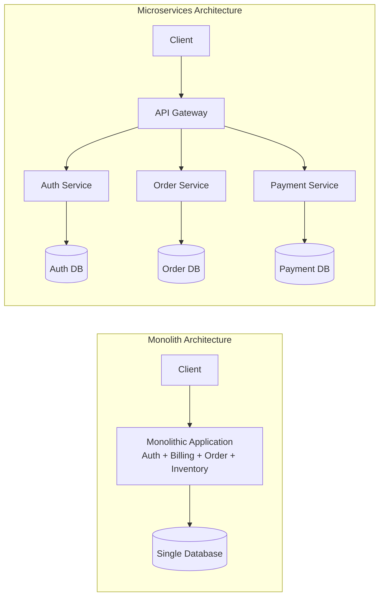

---

### 2. Monolith arxitekturasining afzalliklari va kamchiliklari nimada? / What are the pros and cons of Monolithic Architecture?
> **UZ:**  
> **Afzalliklari:** Sodda ko'chirish (deployment), oson lokal testing/debugging, ACID tranzaksiyalarni bitta ma'lumotlar bazasida boshqarish qulayligi, past tarmoq kechikishi (network latency).  
> **Kamchiliklari:** Kod bazasi kattalashishi bilan sekinlashuv, bitta moduldagi xato butun tizimni yiqitishi (Single Point of Failure), qiyin masshtablanish (butun monolithni scale qilish shart), texnologik stekni o'zgartirish qiyinligi.  
> **EN:**  
> **Pros:** Simple deployment, easy local testing/debugging, straightforward ACID transactions, zero inter-service network latency.  
> **Cons:** Codebase becomes unwieldy, single point of failure (one bug crashes entire app), inefficient scaling (must scale entire monolith), hard to adopt new tech stacks.

---

### 3. Microservices arxitekturasining afzalliklari va kamchiliklari nimada? / What are the pros and cons of Microservices Architecture?
> **UZ:**  
> **Afzalliklari:** Mustaqil deploy qilish, har bir servisni alohida masshtablash (horizontal scaling), texnologik erkinlik (polyglot architecture), bitta servis to'xtashi butun tizimni yiqitmaydi (Fault Tolerance).  
> **Kamchiliklari:** Tarmoq kechikishi (latency), taqsimlangan tranzaksiyalarni boshqarish qiyinligi (Distributed Transactions), murakkab observability (logging/tracing), CI/CD va infratuzilma xarajatlarining yuqoriligi.  
> **EN:**  
> **Pros:** Independent deployments, granular horizontal scaling, tech stack flexibility, fault isolation.  
> **Cons:** Network latency overhead, complex distributed transactions (no simple ACID), complicated observability, higher operational/DevOps overhead.

| Xususiyat / Feature | Monolith 🏛️ | Microservices 🧩 |
|---|---|---|
| Deployment | Yagona build (Single artifact) | Ko'plab mustaqil servislar |
| Database | Bitta umumiy DB | Service-per-database pattern |
| Tranzaksiya | Mahalliy ACID tranzaksiya | Distributed Saga / Eventual Consistency |
| Scaling | Vertical / Full horizontal scale | Har bir servisni alohida scaling |
| Complexity | Kod darajasida murakkab | Infratuzilma darajasida murakkab |

---

### 4. REST API nima va uning asosiy prinsiplari (Constraints) qaysilar? / What is REST API and its core architectural constraints?
> **UZ:** REST (Representational State Transfer) — tarmoq ilovalari uchun stateless arxitektura uslubi. Asosiy 6 constraint:  
> 1. **Client-Server:** Interfeys va ma'lumotlarni saqlash ajratilgan.  
> 2. **Stateless:** Server har bir so'rovni alohida ko'radi, session holatini saqlamaydi.  
> 3. **Cacheable:** Javoblar cache qilinishi mumkinligi ko'rsatiladi.  
> 4. **Uniform Interface:** Resurslar URI orqali aniqlanadi, standart HTTP metodlar (GET, POST, PUT, DELETE) ishlatiladi.  
> 5. **Layered System:** Client oradagi proxy, load balancer yoki gateway mavjudligini bilmaydi.  
> 6. **Code on Demand (Optional):** Server clientga ijro etiluvchi kod (masalan JavaScript) yuborishi mumkin.  
> **EN:** REST is a stateless architectural style for web services. Its 6 key constraints are: Client-Server separation, Statelessness, Cacheability, Uniform Interface (URIs + standard HTTP methods), Layered System, and Code on Demand (optional).

```http
GET /api/v1/orders/1042 HTTP/1.1
Host: api.example.com
Accept: application/json
Authorization: Bearer eyJhbGciOi...
```

---

### 5. gRPC nima va u REST API dan nimasi bilan farq qiladi? / What is gRPC and how does it differ from REST API?
> **UZ:** gRPC — Google tomonidan yaratilgan yuqori unumdorli, ochoq manbali RPC (Remote Procedure Call) freymvorki. HTTP/2 protokoli va Protocol Buffers (protobuf) ikkilik (binary) serialization formatidan foydalanadi.  
> **EN:** gRPC is a high-performance open-source RPC framework developed by Google. It leverages HTTP/2 transport and Protocol Buffers (protobuf) binary serialization format.

| Xususiyat / Feature | REST API 🌐 | gRPC ⚡ |
|---|---|---|
| Protokol / Protocol | HTTP/1.1 or HTTP/2 | HTTP/2 (Multiplexing, Streaming) |
| Format / Payload | JSON / XML (Text-based) | Protocol Buffers (Binary) |
| Performance | Nisbatan sekin, katta payload | Juda tez, yengil payload |
| Schema Contract | OpenAPI / Swagger (Ixtiyoriy) | `.proto` fayllar (Majburiy) |
| Streaming | Cheklangan (SSE/WebSockets) | Unary, Client-stream, Server-stream, Bi-directional |

```protobuf
// Example user.proto
syntax = "proto3";

package user;

service UserService {
  rpc GetUser (UserRequest) returns (UserResponse);
}

message UserRequest {
  string user_id = 1;
}

message UserResponse {
  string user_id = 1;
  string name = 2;
  string email = 3;
}
```

---

### 6. Layer 4 va Layer 7 Load Balancing o'rtasidagi farq nimada? / Difference between Layer 4 and Layer 7 Load Balancing?
> **UZ:**  
> **Layer 4 (Transport Layer):** Transport darajasida (IP va TCP/UDP portlar) ishlaydi. Paket tarkibini (HTTP header, URL, Body) o'qimaydi. Juda tez va yengil (masalan, HAProxy L4, AWS NLB).  
> **Layer 7 (Application Layer):** Application darajasida (HTTP/HTTPS, Headers, Cookies, URL Path) ishlaydi. So'rov mazmuniga qarab routing qilishi mumkin (masalan, `/api/users` server 1 ga, `/api/orders` server 2 ga). SSL termination va rate limiting qiladi (masalan, Nginx, HAProxy L7, AWS ALB).  
> **EN:**  
> **Layer 4 (Transport):** Routes traffic based on IP address and TCP/UDP ports without inspecting packet payloads. Extremely fast (AWS NLB, HAProxy L4).  
> **Layer 7 (Application):** Inspects application-level content (HTTP headers, URLs, cookies). Enables content-based routing, SSL termination, and header manipulation (AWS ALB, Nginx).

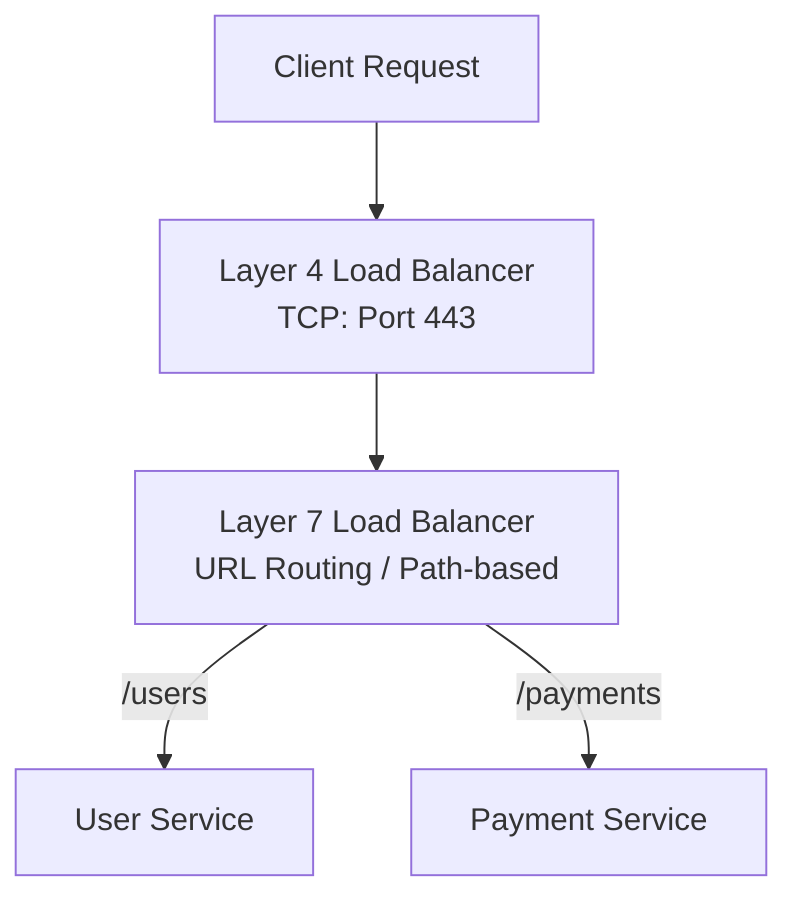

---

### 7. Load Balancing algoritmlari qaysilar? / What are common Load Balancing algorithms?
> **UZ:**  
> 1. **Round Robin:** Serverlarga navbatma-navbat ketma-ket joylashtiradi.  
> 2. **Weighted Round Robin:** Server quvvatiga (RAM/CPU) qarab vazn (weight) beriladi.  
> 3. **Least Connections:** Eng kam faol ulanishga ega serverga so'rovni yuboradi.  
> 4. **Weighted Least Connections:** Server vazni va ulanishlar soni birga hisoblanadi.  
> 5. **IP Hash:** Client IP manzilidan hash olinadi, bitta client har doim bitta serverga tushadi (Session Sticky).  
> 6. **Least Response Time:** Eng kam javob vaqtiga (latency) ega serverni tanlaydi.  
> **EN:**  
> Key algorithms include Round Robin, Weighted Round Robin, Least Connections, Weighted Least Connections, IP Hash (sticky sessions), and Least Response Time.

---

### 8. Hardware va Software Load Balancer'lar farqi va mashhur namunalari? / Difference between Hardware and Software Load Balancers with examples?
> **UZ:**  
> **Hardware Load Balancers:** Maxsus apparat vositalari (F5 BIG-IP, Citrix ADC). Juda yuqori throughput beradi, lekin qimmat va infratuzilmani moslashtirish qiyin.  
> **Software Load Balancers:** Standart serverlarda ishlaydigan dasturiy yechimlar (Nginx, HAProxy, Envoy, Traefik). Moslashuvchan, arzon, cloud/K8s muhitiga mos.  
> **EN:** Hardware balancers (F5 BIG-IP, Citrix) use dedicated physical appliances offering massive throughput at high cost. Software balancers (Nginx, HAProxy, Envoy, Traefik) run on commodity hardware, offering flexibility, lower cost, and cloud-native integration.

---

### 9. In-Memory Caching va Distributed Caching nimasi bilan farqlanadi? / What is the difference between In-Memory Caching and Distributed Caching?
> **UZ:**  
> **In-Memory Caching (Local Cache):** Ilova xotirasida (RAM) saqlanadi (masalan, Guava, Ehcache, Python `functools.lru_cache`). Juda tez, lekin har bir app node alohida keshga ega bo'ladi (ma'lumotlar duplikasiyasi va nomuvofiqligi kelib chiqadi).  
> **Distributed Caching:** Alohida kesh serverlar klasterida saqlanadi (Redis, Memcached). Barcha app nodelar yagona kesh manbasiga murojaat qiladi, scaling oson.  
> **EN:** Local In-Memory Cache lives inside the application process memory (fastest, but decentralized per node). Distributed Cache (Redis, Memcached) runs as an independent cluster shared across all application nodes.

---

### 10. Redis va Memcached o'rtasidagi asosiy farqlar nimada? / What are the key differences between Redis and Memcached?
> **UZ:**  
> **Redis:** Ko'p turdagi ma'lumot tuzilmalarini (Strings, Hashes, Lists, Sets, Sorted Sets, Bitmaps) qo'llab-quvvatlaydi, diska persistence (RDB/AOF), Pub/Sub, Lua skriptlar va Replication/Cluster qo'llaydi. Single-threaded I/O multiplexing event loop'da ishlaydi.  
> **Memcached:** Faqat oddiy Key-Value (String) saqlaydi, multithreaded architecture, faqat volatile in-memory (persistence yo'q). Juda oddiy va yengil string kesh uchun mos.  
> **EN:** Redis supports rich data structures, persistence (RDB/AOF), replication, pub/sub, and clustering in a single-threaded event loop. Memcached is a multithreaded, simple key-value volatile memory store focused purely on basic caching.

| Xususiyat / Feature | Redis 🔴 | Memcached ⚡ |
|---|---|---|
| Data Types | Strings, Hashes, Lists, Sets, ZSets, Geospatial | Simple Key-Value (String) |
| Persistence | ✅ RDB Snapshots & AOF Logs | ❌ Faqat RAM (Volatile) |
| Threading | Single-Threaded Event Loop (Redis 6+ I/O multi-thread) | Multi-Threaded Architecture |
| Clustering | ✅ Native Redis Cluster (16384 Hash Slots) | ❌ Client-side Consistent Hashing |
| Pub/Sub & Transactions | ✅ Qo'llab-quvvatlaydi | ❌ Mavjud emas |

---

### 11. Redis Ma'lumot Turlari va amaliy ishlatilish holatlari? / Redis Data Types and real-world use cases?
> **UZ:**  
> 1. **String:** HTML kesh, Auth tokenlar (`SET user:100 "token"`).  
> 2. **Hash:** Foydalanuvchi profili (`HSET user:100 name "Ali" age 25`).  
> 3. **List:** Xabarlar navbati, so'nggi harakatlar (`LPUSH queue "job1"`, `RPOP queue`).  
> 4. **Set:** Unikal elementlar, masalan IP mehmonlar (`SADD unique_ips "192.168.1.1"`).  
> 5. **Sorted Set (ZSet):** Leaderboard, reytinglar, Rate Limiting (`ZADD leaderboard 1500 "player1"`).  
> 6. **Bitmap / HyperLogLog:** Kunlik aktiv foydalanuvchilar (DAU) va kardinal statistikalar.  
> **EN:** Redis data types serve specific use cases: Strings (HTML/token cache), Hashes (object entities), Lists (job queues), Sets (unique tags/IPs), Sorted Sets (leaderboards, rate limiters), Bitmaps/HyperLogLog (DAU, unique counts).

```python
# Redis Sorted Set rate limiter example in Python
import redis
import time

r = redis.Redis(host='localhost', port=6379, db=0)

def is_rate_limited(user_id: str, limit: int = 5, window_seconds: int = 60) -> bool:
    current_time = time.time()
    key = f"rate_limit:{user_id}"
    pipe = r.pipeline()
    # Purge old requests outside the rolling window
    pipe.zremrangebyscore(key, 0, current_time - window_seconds)
    # Add current timestamp
    pipe.zadd(key, {str(current_time): current_time})
    # Count requests in current window
    pipe.zcard(key)
    # Set TTL
    pipe.expire(key, window_seconds)
    results = pipe.execute()
    
    request_count = results[2]
    return request_count > limit
```

---

### 12. Database Vertical Scaling (Scale-up) vs Horizontal Scaling (Scale-out)? / Database Vertical Scaling vs Horizontal Scaling?
> **UZ:**  
> **Vertical Scaling (Scale-up):** Serverga ko'proq resurs qo'shish (CPU, RAM, NVMe SSD). Sodda, kod o'zgartirish talab qilmaydi, lekin apparat chegarasiga (hardware limit) uchraydi va juda qimmatlashadi.  
> **Horizontal Scaling (Scale-out):** Ko'proq serverlar qo'shish (Read Replicas, Sharding). Cheksiz masshtablanish imkonini beradi, lekin koddagi va arxitekturadagi murakkablikni oshiradi.  
> **EN:** Vertical Scaling adds more hardware capacity (CPU, RAM) to a single machine (simple, but hits physical limits and high costs). Horizontal Scaling adds more nodes (sharding, read replicas), offering unlimited scale at the expense of architectural complexity.

---

### 13. Database Primary-Replica (Master-Slave) arxitekturasi qanday ishlaydi? / How does Primary-Replica (Master-Slave) Replication work?
> **UZ:** Yozish (WRITE/UPDATE/DELETE) operatsiyalari faqat **Primary (Master)** tugunga bajariladi. Primary server ma'lumot o'zgarishlarini Write-Ahead Log (WAL) yoki Binlog orqali **Replica (Slave)** serverlarga asinxron yoki sinxron replikatsiya qiladi. O'qish (READ) so'rovlari Replica serverlar o'rtasida taqsimlanadi.  
> **EN:** Writes are routed exclusively to the Primary node, which records change logs (WAL/Binlog) and replicates them (synchronously or asynchronously) to Replica nodes. Read queries are distributed across Replicas to scale read throughput.

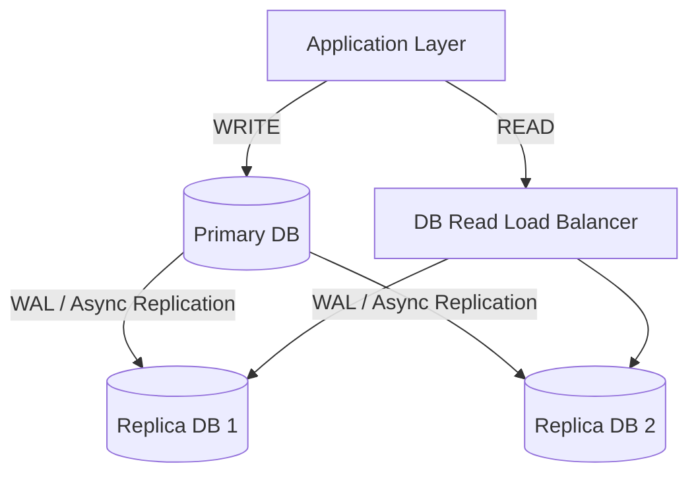

---

### 14. DNS (Domain Name System) nima va u qanday ishlaydi? / What is DNS and how does resolution work?
> **UZ:** DNS — domen nomlarini (masalan, `example.com`) IP manzillarga (`192.0.2.1`) o'giruvchi taqsimlangan katalog tizimi. Resolution ketma-ketligi:  
> 1. Browser Cache / OS Hosts file.  
> 2. Recursive DNS Resolver (ISP / 8.8.8.8).  
> 3. Root Name Server (`.`).  
> 4. TLD Name Server (`.com`).  
> 5. Authoritative Name Server (`example.com`).  
> **EN:** DNS translates human-readable domain names into IP addresses. Resolution steps: Browser Cache -> Recursive Resolver -> Root Server -> TLD Server -> Authoritative DNS Server.

---

### 15. Anycast DNS va GeoDNS nima? / What are Anycast DNS and GeoDNS routing?
> **UZ:**  
> **GeoDNS:** So'rov yuborgan foydalanuvchining IP manzilining geografik joylashuviga qarab unga eng yaqin server IP manzilini qaytaradi.  
> **Anycast DNS:** Bir xil IP manzil dunyo bo'ylab BGP (Border Gateway Protocol) orqali bir nechta serverlarga biriktiriladi. Tarmoq marshrutizatorlari so'rovni avtomatik ravishda eng yaqin (asosiy BGP hop soni bo'yicha) pop-serverga yo'naltiradi.  
> **EN:** GeoDNS resolves domain names based on the geographical location of the client's IP. Anycast DNS advertises the exact same IP address from multiple global locations via BGP, routing users to the topologically nearest edge server.

---

### 16. Content Delivery Network (CDN) nima va u static fayllarni qanday yetkazadi? / What is a CDN and how does it deliver static assets?
> **UZ:** CDN — dunyo bo'ylab tarqalgan serverlar tarmog'i (Edge Locations). Rasm, CSS, JS, video va boshqa static fayllarni foydalanuvchiga geografik eng yaqin serverdan keshlab beradi. Bu origin server yukini kamaytiradi va kechikishni (latency) keskin qisqartiradi.  
> **EN:** A CDN is a globally distributed network of edge servers that cache static assets (images, JS, CSS, video) close to end-users, dramatically reducing network latency and origin server load.

---

### 17. Pull CDN vs Push CDN farqi nimada? / What is the difference between Pull CDN and Push CDN?
> **UZ:**  
> **Pull CDN (Reverse Proxy CDN):** Edge server faqat foydalanuvchi so'raganda origin serverdan faylni birinchi marta tortib oladi (pull) va keshlaydi. TTL tugaguncha saqlaydi. Trafik kam bo'lgan platformalar uchun mos.  
> **Push CDN:** Ishlab chiquvchi yangi fayllarni origin serverdan CDN edge serverlarga kontent yangilanganda avtomatik yuklaydi (push). Katta hajmga ega va kam yangilanadigan fayllar uchun mos.  
> **EN:** Pull CDN fetches static content from the origin on-demand when requested by an end-user. Push CDN requires content to be uploaded directly to the CDN whenever changes occur.

---

### 18. Reverse Proxy va Forward Proxy o'rtasidagi farq nimada? / Difference between Reverse Proxy and Forward Proxy?
> **UZ:**  
> **Forward Proxy:** Client tomonida turadi. Clientlar shaxsini (IP) yashirish, kontentni filtrlash yoki bloklangan saytlarga kirish uchun foydalanadi (masalan, corporate proxy, VPN).  
> **Reverse Proxy:** Serverlar tomonida turadi. Clientlar bilan serverlar o'rtasida vositachilik qiladi. Serverlarni yashirish, load balancing, SSL termination, caching va rate limiting uchun xizmat qiladi (masalan, Nginx, HAProxy).  
> **EN:** A Forward Proxy acts on behalf of clients (hiding client IP, bypass firewalls). A Reverse Proxy acts on behalf of backend servers (hiding server infrastructure, balancing load, terminating TLS, caching).

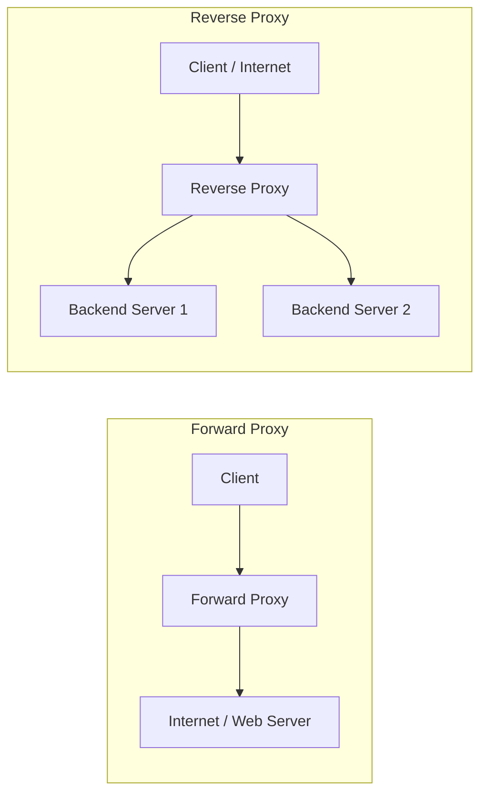

---

### 19. Nginx Reverse Proxy va Load Balancer konfiguratsiya namunasi? / Nginx Reverse Proxy & Load Balancer Configuration Example?
> **UZ:** Nginx so'rovlarni bir nechta backend upstream serverlarga `proxy_pass` orqali taqsimlashi va SSL ni boshqarishi mumkin.  
> **EN:** Nginx handles request forwarding, upstream load balancing, and TLS termination using simple directives.

```nginx
# /etc/nginx/nginx.conf
http {
    upstream backend_services {
        least_conn; # Algorithm: Least Connections
        server backend1.example.com:8080 weight=3;
        server backend2.example.com:8080 weight=1;
        server backend3.example.com:8080 backup;
    }

    server {
        listen 443 ssl http2;
        server_name api.example.com;

        ssl_certificate /etc/letsencrypt/live/api.example.com/fullchain.pem;
        ssl_certificate_key /etc/letsencrypt/live/api.example.com/privkey.pem;

        location / {
            proxy_pass http://backend_services;
            proxy_set_header Host $host;
            proxy_set_header X-Real-IP $remote_addr;
            proxy_set_header X-Forwarded-For $proxy_add_x_forwarded_for;
            proxy_set_header X-Forwarded-Proto $scheme;
        }
    }
}
```

---

### 20. Stateless va Stateful ilovalar arxitekturasi nima? / Stateless vs Stateful Application Architecture?
> **UZ:**  
> **Stateless Architecture:** App server hech qanday client session ma'lumotlarini xotirada saqlamaydi. Har bir so'rov barcha kerakli autentifikatsiya ma'lumotlarini (masalan, JWT token) o'zi bilan olib keladi. Istalgan so'rov istalgan app serverga tushishi mumkin (Horizontal scaling oson).  
> **Stateful Architecture:** App server client session holatini (Session state) o'z RAMida saqlaydi. Client so'rovlari faqat o'sha serverga borishi kerak (Sticky Session), bu esa horizontal scaling va failoverni murakkablashtiradi.  
> **EN:** Stateless applications store no client session data in process memory, enabling seamless horizontal scaling. Stateful applications retain user state on the node, requiring sticky sessions and complex failover strategies.

---

### 21. HTTP/1.1 vs HTTP/2 vs HTTP/3 (QUIC) taqqoslamasi? / HTTP/1.1 vs HTTP/2 vs HTTP/3 (QUIC) Comparison?
> **UZ:**  
> - **HTTP/1.1:** Text-based protokol. Head-of-Line (HOL) Blocking muammosi bor (bitta TCP ulanishda so'rovlar navbatda turadi).  
> - **HTTP/2:** Binary format. Multiplexing — bitta TCP ulanish orqali bir vaqtning o'zida parallel so'rovlar yuboriladi. Header Compression (HPACK), Server Push.  
> - **HTTP/3:** TCP o'rniga UDP ga asoslangan **QUIC** protokoli ishlatiladi. Transport darajasidagi HOL blocking muammosi bartaraf etilgan, IP o'zgarsa ham ulanish uzilmaydi (Connection ID).  
> **EN:** HTTP/1.1 suffers from Head-of-Line blocking. HTTP/2 introduces binary multiplexing over a single TCP connection. HTTP/3 moves from TCP to UDP-based QUIC, eliminating transport HOL blocking and enabling seamless connection migration.

---

### 22. WebSockets, Long Polling va Server-Sent Events (SSE) farqlari? / WebSockets vs Long Polling vs Server-Sent Events (SSE)?
> **UZ:**  
> - **Long Polling:** Client serverga HTTP so'rov yuboradi, server ma'lumot bo'lguncha ulanishni ochiq tutadi va javob berishi bilan ulanish yopiladi. Yangi so'rov ochiladi. Overhead yuqori.  
> - **Server-Sent Events (SSE):** HTTP orqali bir tomonlama (Server -> Client) real-time streaming. Yangiliklar lentalari, live feed uchun mos.  
> - **WebSockets:** TCP ustida to'liq ikki tomonlama (Full-Duplex) doimiy ulanish. Chat, live game, birja savdolari uchun mos.  
> **EN:** Long Polling re-establishes HTTP connections iteratively. SSE maintains a persistent unidirectional server-to-client HTTP stream. WebSockets establish full-duplex, bi-directional persistent TCP connections.

---

### 23. Database Connection Pooling nima va u nima uchun kerak? / What is Database Connection Pooling and why is it essential?
> **UZ:** Har bir ma'lumotlar bazasi ulanishini (DB connection) ochish TCP handshake, authentication va xotira ajratish tufayli resurs jihatidan qimmatga tushadi. Connection Pool (masalan, HikariCP, PgBouncer) oldindan tayyor ulanishlar havzasini yaratib qo'yadi. Ilova so'rov kelganda tayyor ulanishni oladi va ishlatib bo'lgach havzaga qaytaradi.  
> **EN:** Creating a DB connection requires TCP handshakes and process allocation overhead. A Connection Pool (e.g., HikariCP, PgBouncer) maintains a reusable pool of warm connections, eliminating connection setup latency under heavy traffic.

---

### 24. Database Indexing nima va B-Tree vs Hash Index farqlari? / Database Indexing principles: B-Tree vs Hash Index?
> **UZ:** Indeks — jadvaldagi ma'lumotlarni tezroq topish uchun alohida saqlanadigan ma'lumot tuzilmasi.  
> - **B-Tree Index:** Balanslashgan daraxt. Tenglik (`=`) va interval querylar (`<`, `>`, `BETWEEN`, `ORDER BY`) uchun ishlaydi.  
> - **Hash Index:** Hash table ishlatadi. O(1) tenglik taqqoslash uchun juda tez (`WHERE id = 5`), lekin interval (`<`, `>`) va tartiblash (`ORDER BY`) uchun ishlamaydi.  
> **EN:** Indexes speed up retrieval at the expense of write overhead. B-Trees support range scans and ordering; Hash indexes only support O(1) exact equality lookups.

---

### 25. Object (Blob) Storage vs Relational Database storage farqlari? / Object (Blob) Storage vs Relational Storage?
> **UZ:** Rasm, video, audio, PDF kabi katta strukturaga ega bo'lmagan fayllarni (Unstructured Data) ma'lumotlar bazasining o'zida `BYTEA`/`BLOB` sifatida saqlash DB unumdorligini va zaxira nusxalashni (backup) sekinlashtiradi. Bunday fayllar **Object Storage** da (AWS S3, MinIO, Google Cloud Storage) saqlanadi, DB da esa faqat faylning URL manzili (String) saqlanadi.  
> **EN:** Storing large binary files in relational databases degrades DB I/O and bloats backups. Unstructured assets (images, videos, documents) belong in Object Storage (AWS S3, MinIO), while relational DBs store only the metadata and file URL references.

---

## 🟡 2. O'rta daraja / Intermediate Level (26–55)

---

### 26. Message Queue nima va microservices da u qanday muammolarni hal qiladi? / What is a Message Queue and what problems does it solve?
> **UZ:** Message Queue — microservices o'rtasida asinxron xabar almashish mexanizmi. U quyidagi muammolarni hal qiladi:  
> 1. **Decoupling (Mustaqillik):** Servislar bir-birining mavjudligiga to'g'ridan-to'g'ri bog'liq bo'lmaydi.  
> 2. **Asynchronous Processing:** Og'ir vazifalarni (email yuborish, video transcode) backgroundda bajarish.  
> 3. **Peak Shaving / Load Leveling:** Keskin oshgan trafikni navbatda saqlab, consumer imkoniyati darajasida sekin-asta qayta ishlash.  
> **EN:** Message Queues decouple services, enable asynchronous background processing, and buffer traffic spikes (load smoothing) to protect downstream microservices from overload.

---

### 27. Message Queue (RabbitMQ) vs Event Streaming Platform (Kafka) farqlari? / Difference between Message Queues (RabbitMQ) and Event Streaming (Kafka)?
> **UZ:**  
> - **RabbitMQ (Smart Broker, Dumb Consumer):** Push-based model. Xabarlar qayta ishlangach va ACK olingach navbatdan o'chiriladi. Murakkab routing (topic, headers, fanout) mavjud.  
> - **Apache Kafka (Dumb Broker, Smart Consumer):** Pull-based model. Xabarlar append-only immutable commit log sifatida belgilangan vaqt (retention time) saqlanadi. Har bir consumer o'z **offset** ini boshqaradi. Millionlab eventlarni yuqori tezlikda o'qish uchun mo'ljallangan.  
> **EN:** RabbitMQ pushes messages to consumers and deletes them post-acknowledgment. Kafka acts as a persistent append-only log where consumers pull messages at their own pace using offset tracking.

---

### 28. RabbitMQ arxitekturasi va Exchange turlari qaysilar? / RabbitMQ Architecture and Exchange types?
> **UZ:** Producer xabarni to'g'ridan-to'g'ri Queue ga yubormaydi, balki **Exchange** ga yuboradi. Exchange xabarni **Routing Key** va **Binding** qoidalari asosida Queue larga joylaydi. Exchange turlari:  
> 1. **Direct Exchange:** Routing key aniq mos kelganda queue ga yo'naltiradi.  
> 2. **Fanout Exchange:** Routing key ga qaramasdan so'rovni barcha bog'langan queue larga tarqatadi (Publish-Subscribe).  
> 3. **Topic Exchange:** Wildcard patternlar bo'yicha routing qiladi (masalan `order.*.created`, `*.europe.#`).  
> 4. **Headers Exchange:** Routing key o'rniga message header qiymatlaridan foydalanadi.  
> **EN:** RabbitMQ producers publish to Exchanges, which route messages to Queues via Bindings. Exchange types: Direct (exact routing key), Fanout (broadcast), Topic (pattern matching), Headers (header attributes).

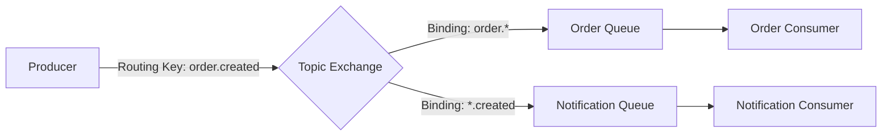

---

### 29. Apache Kafka arxitekturasi: Topic, Partition, Offset va Consumer Group? / Apache Kafka Architecture: Topic, Partition, Offset, Consumer Group?
> **UZ:**  
> - **Topic:** Xabarlar kategoriyasi.  
> - **Partition:** Topic bir nechta parallel fayllarga (partition) bo'linadi. Har bir partition alohida brokerda joylashishi mumkin (Horizontal scaling va parallelism).  
> - **Offset:** Partition ichidagi har bir xabarning ketma-ket unikal raqami.  
> - **Consumer Group:** Bitta guruhdagi consumerlar partitionlarni o'zaro bo'lishib o'qiydi. Bitta partition guruh ichidagi faqat bitta consumer ga biriktiriladi.  
> **EN:** Kafka topics are split into partitions distributed across brokers. Offsets track message ordering per partition. Consumer groups distribute partition reading dynamically among member consumers.

---

### 30. Message Delivery Guarantees (Yetkazib berish kafolatlari) qanday turga bo'linadi? / Message Delivery Guarantees in Distributed Systems?
> **UZ:**  
> 1. **At-Most-Once:** Xabar 0 yoki 1 marta yetkaziladi. Xabar yo'qolishi mumkin, lekin takrorlanmaydi.  
> 2. **At-Least-Once:** Xabar 1 yoki undan ko'p marta yetkaziladi. Xabar yo'qolmaydi, lekin tarmoq uzilishida takroriy xabarlar kelishi mumkin (Idempotent consumer talab etiladi).  
> 3. **Exactly-Once:** Xabar to'liq va aniq bitta marta yetkaziladi va qayta ishlanadi (Eng qimmat va murakkab, Kafka Transactional Producer/Consumer orqali ta'minlanadi).  
> **EN:** At-most-once guarantees no duplicates but risks message loss. At-least-once ensures no loss but risks duplicates (requires idempotent processing). Exactly-once guarantees precise single execution.

---

### 31. Idempotency nima va idempotent API/Consumer qanday loyihalashtiriladi? / What is Idempotency and how to design Idempotent APIs?
> **UZ:** Idempotency — operatsiyani bir necha bor bir xil parametrlar bilan takroran bajarish tizim holatini faqat birinchi marta bajarilgandagi kabi o'zgarishiga olib kelishi. HTTP GET, PUT, DELETE idempotent, POST esa non-idempotent.  
> **Idempotent Design Strategy:**  
> Client har bir so'rov bilan yagona `Idempotency-Key` (UUID) yuboradi. Server bu keyni keshda (Redis) yoki DB da tekshiradi: agar mavjud bo'lsa, qayta ijro etmasdan avvalgi natijani qaytaradi.  
> **EN:** Idempotency ensures that repeating an operation produces the same system state as a single execution. Implemented using unique `Idempotency-Key` tracking in Redis/DB.

```python
# FastAPI Idempotency Key Middleware strategy
from fastapi import FastAPI, Request, HTTPException
import redis

app = FastAPI()
r = redis.Redis(host='localhost', port=6379, db=0)

@app.post("/payments/charge")
async def process_payment(request: Request):
    idempotency_key = request.headers.get("X-Idempotency-Key")
    if not idempotency_key:
        raise HTTPException(status_code=400, detail="Missing Idempotency Key")

    # Check if request was already processed
    lock_acquired = r.set(f"idempotency:{idempotency_key}", "processing", nx=True, ex=120)
    if not lock_acquired:
        cached_response = r.get(f"result:{idempotency_key}")
        if cached_response:
            return {"status": "SUCCESS", "message": "Duplicate request ignored", "data": cached_response.decode()}
        raise HTTPException(status_code=409, detail="Request currently processing")

    # Business Logic: Charge Credit Card
    payment_result = {"transaction_id": "tx_99812", "amount": 100.0}
    
    # Save result for future retries
    r.set(f"result:{idempotency_key}", str(payment_result), ex=86400)
    return payment_result
```

---

### 32. Database Partitioning turlari (Horizontal vs Vertical, Range, List, Hash)? / Database Partitioning Types?
> **UZ:** Partitioning — bitta katta jadvalni kichikroq qismlarga bo'lish.  
> - **Vertical Partitioning:** Ustunlar bo'yicha bo'lish (masalan, ko'p ishlatiladigan ustunlar bitta jadvalda, kam ishlatiladigan katta TEXT ustunlar boshqasida).  
> - **Horizontal Partitioning (Range):** Qiymatlar diapazoni bo'yicha bo'lish (`created_at BETWEEN '2026-01-01' AND '2026-02-01'`).  
> - **List Partitioning:** Aniq qiymatlar ro'yxati bo'yicha (`region IN ('UZ', 'KZ', 'TJ')`).  
> - **Hash Partitioning:** Kalitning `hash(id) % num_partitions` formula bo'yicha bo'linishi.  
> **EN:** Partitioning divides large tables into smaller physical segments. Vertical divides columns; Horizontal divides rows via Range (dates), List (discrete categories), or Hash (uniform math distribution).

---

### 33. Database Sharding nima va Sharding Kaliti (Shard Key) qanday tanlanadi? / What is Database Sharding and how to choose a Shard Key?
> **UZ:** Sharding — ma'lumotlar bazasi jadvalini bir nechta **mustaqil fizik serverlar (Shards)** bo'ylab bo'lib saqlash.  
> **Shard Key tanlash mezoni:**  
> Shard Key yaxshi tanlanmasa, ma'lumotlar bitta sharda yig'ilib qoladi (Hotspotting problem). Yaxshi Shard Key yuqori kardinality (yuqori xilma-xillik) ga ega bo'lishi va so'rovlar yukini teng taqsimlashi lozim (masalan, `user_id` yoki `tenant_id`).  
> **EN:** Sharding splits table rows across physically separate database instances. Choosing a high-cardinality Shard Key (e.g. `user_id`) ensures uniform distribution and prevents storage hotspots.

```mermaid
graph TD
    App[Application Code] --> Router[Database Shard Router]
    Router -->|hash(user_id) % 3 == 0| Shard1[(Shard 1 Server<br/>Users 0-33%)]
    Router -->|hash(user_id) % 3 == 1| Shard2[(Shard 2 Server<br/>Users 34-66%)]
    Router -->|hash(user_id) % 3 == 2| Shard3[(Shard 3 Server<br/>Users 67-100%)]
```

---

### 34. Database Sharding chalkashliklari va kamchiliklari? / Major challenges and trade-offs of Database Sharding?
> **UZ:**  
> 1. **Cross-Shard Joins:** Turli shard serverlarida joylashgan jadvallarni JOIN qilib bo'lmaydi (koddagi mantiqda birlashtirish kerak).  
> 2. **Distributed Transactions:** Shardlar o'rtasida ACID tranzaksiyalarni ta'minlash 2PC yoki Saga pattern talab qiladi (sekin va murakkab).  
> 3. **Re-sharding Complexity:** Yangi shard qo'shilganda ma'lumotlarni qayta taqsimlash (Consistent Hashing ishlatilmasa) juda qiyin.  
> 4. **Auto-Increment PKs:** Standart `AUTO_INCREMENT` ishlamaydi (Snowflake ID yoki UUID ishlatish kerak).  
> **EN:** Sharding eliminates native foreign key JOINs across shards, complicates distributed ACID transactions, makes re-balancing data hard, and breaks traditional auto-incrementing primary keys.

---

### 35. Rate Limiting nima va u nima uchun kerak? / What is Rate Limiting and why is it needed?
> **UZ:** Rate Limiting — ma'lum vaqt oralig'ida (masalan, 1 minutda) foydalanuvchi yoki IP tomonidan yuborilishi mumkin bo'lgan maksimal so'rovlar sonini cheklash mexanizmi.  
> **Maqsadi:** DDoS hujumlardan himoyalanish, server resurslarini tejash, servislarning cascade failure bo'lishini oldini olish, API monetizatsiyasini (Tier plans) boshqarish.  
> **EN:** Rate Limiting caps incoming requests per user/IP within a time window to prevent brute-force/DDoS attacks, avoid cascading system failures, and enforce tier-based API usage quotas.

---

### 36. Token Bucket Algoritmi qanday ishlaydi? / How does the Token Bucket Algorithm work?
> **UZ:** Vositaga muayyan sig'imga (Bucket Capacity) ega bo'lgan chelak tasavvur qilinadi. Chelakka ma'lum tezlikda (Refill Rate, masalan 1 sekundda 10 ta) tokenlar tashlab turiladi. Har bir kiruvchi so'rov chelakdan 1 ta token oladi. Agar chelakda token bo'lmasa, so'rov rad etiladi (`429 Too Many Requests`). Tokenlar to'planishi mumkin bo'lgan burst (keskin so meyoriy yuklanish) ga ruxsat beradi.  
> **EN:** A bucket holds up to $N$ tokens and fills at a steady rate. Each request consumes one token. If no tokens remain, the request is rejected with HTTP 429. It natively supports bursty traffic.

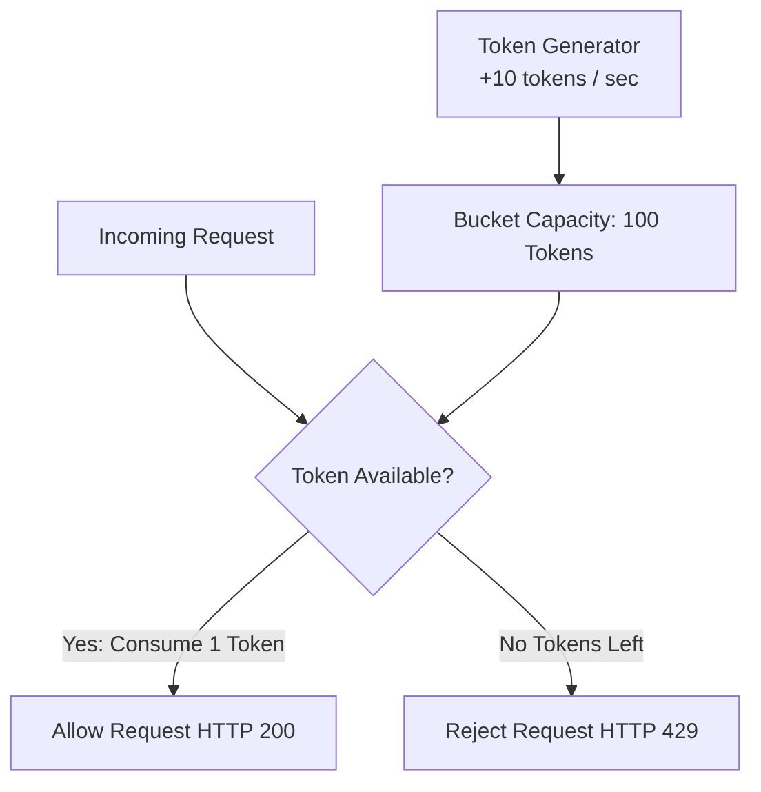

---

### 37. Leaky Bucket Algoritmi qanday ishlaydi? / How does the Leaky Bucket Algorithm work?
> **UZ:** So'rovlar teshik chelakka suvlardek quyiladi (FIFO Queue). Chelak tubidagi teshikdan so'rovlar bir maromda, o'zgarmas doimiy tezlikda (fixed output rate) chiqib turadi. Agar chelak (queue) to'lib ketsa, yangi so'rovlar oqib ketadi (tashlab yuboriladi/429). Keskin kelgan trafikni tekislab, doimiy oqim holatiga keltirish uchun ishlatiladi.  
> **EN:** Requests enter a bounded FIFO queue. The queue drains requests to the backend at a smooth, constant rate regardless of burst sizes. Overflow requests are discarded.

---

### 38. Fixed Window Counter vs Sliding Window Counter Algoritmlari? / Fixed Window Counter vs Sliding Window Counter?
> **UZ:**  
> - **Fixed Window:** Vaqt belgilangan intervalga (masalan 12:00-12:01) bo'linadi. Interval chegarasida (masalan 12:00:59 da 100 ta va 12:01:01 da 100 ta so'rov kelganda) 2 soniya ichida 200 ta so'rov o'tib ketishi (Window Boundary Burst) muammosi bor.  
> - **Sliding Window Counter:** O'tgan va joriy oynalarning foiz nisbatini hisobga olgan holda aniqroq sirpanuvchi oyna hisobini oladi. Chegara muammosini hal qiladi va xotirani kam sarflaydi.  
> **EN:** Fixed Window resets counters at rigid time boundaries, allowing double the rate limit near boundaries. Sliding Window Counter blends current and previous window rates to smooth out boundary spikes memory-efficiently.

---

### 39. Redis va Lua Script yordamida Taqsimlangan Rate Limiter yaratish? / Distributed Rate Limiter with Redis and Lua Script?
> **UZ:** Redis va Lua skript ishlatilishi Atomicity ni ta'minlaydi (race condition yuzaga kelmaydi).  
> **EN:** Executing rate limiting logic inside Redis via a Lua script ensures single-threaded atomic execution, avoiding race conditions across distributed microservices.

```lua
-- rate_limiter.lua
local key = KEYS[1]
local limit = tonumber(ARGV[1])
local window = tonumber(ARGV[2])

local current = redis.call('INCR', key)
if current == 1 then
    redis.call('EXPIRE', key, window)
end

if current > limit then
    return 0 -- Rate Limited
else
    return 1 -- Allowed
end
```

---

### 40. API Gateway Pattern nima va uning asosiy vazifalari? / What is the API Gateway Pattern and its key responsibilities?
> **UZ:** API Gateway — barcha tashqi clientlar uchun yagona kirish nuqtasi (Single Entry Point).  
> **Asosiy vazifalari:** So'rovlarni ichki servisga yo'naltirish (Routing), Auth/JWT verification, Rate Limiting, SSL Termination, Response Caching, Request/Response Transformation, Observability (Logging/Metrics).  
> **EN:** An API Gateway acts as a reverse proxy single entry point for all client devices, orchestrating request routing, authentication, rate limiting, SSL termination, and protocol translation.

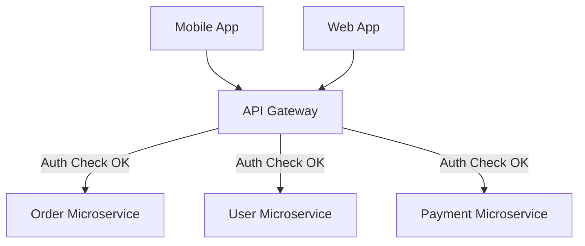

---

### 41. API Gateway vs Service Mesh va Backend for Frontend (BFF) Pattern? / API Gateway vs Service Mesh & BFF Pattern?
> **UZ:**  
> - **API Gateway:** Tashqi trafikni (North-South traffic) boshqaradi.  
> - **Service Mesh (Istio, Linkerd):** Ichki microservices o'rtasidagi trafikni (East-West traffic) sidecar proxy (Envoy) orqali boshqaradi (mTLS, retry, circuit breaking).  
> - **BFF (Backend for Frontend):** Har bir turdagi client (Web, Mobile, Smart TV) uchun alohida sozlangan maxsus API Gateway yechimi.  
> **EN:** API Gateways manage North-South (external to internal) traffic. Service Meshes manage East-West (service to service) internal communications via sidecars. BFF creates tailored gateways for different client form factors.

---

### 42. Microservices da Distributed Transactions muammosi nima? / What is the Distributed Transactions problem in Microservices?
> **UZ:** Microservices arxitekturasida har bir servis o'zining alohida ma'lumotlar bazasiga (Database-per-service pattern) ega. Buyurtma berish jarayonida Buyurtma servisi, To'lov servisi va Ombor servisi ishtirok etsa, barcha servislar bo'ylab bitta umumiy ACID tranzaksiyasini qo'llab bo'lmaydi. Bir servisda xato bo'lsa, avval bajarilgan servislardagi ma'lumotlarni ortga qaytarish (Rollback) muammosi yuzaga keladi.  
> **EN:** With database-per-service, a single ACID transaction cannot span multiple databases over a network. If step 3 fails, steps 1 and 2 cannot simply be database-rolled-back automatically.

---

### 43. Two-Phase Commit (2PC) Protokoli va uning kamchiliklari? / What is Two-Phase Commit (2PC) Protocol and its flaws?
> **UZ:** 2PC — distributed ACID tranzaksiya protokoli.  
> 1. **Prepare Phase:** Koordinator barcha tugunlarga "Tranzaksiyaga tayyormisiz?" deb so'rov yuboradi. Hamma "YES" deydi va resurslarni bloklaydi (lock).  
> 2. **Commit Phase:** Koordinator barcha tugunlarga "Commit" buyrug'ini yuboradi.  
> **Kamchiliklari:** Sinxron va blocking protokol. Resurslar uzoq vaqt bloklanib qoladi (low throughput), Koordinator yiqilsa (Single Point of Failure), butun tizim muzlab qoladi.  
> **EN:** 2PC coordinates atomic commits via Prepare and Commit phases. It is strictly blocking and slow, locking database resources across network hops, making it unsuitable for high-throughput microservices.

---

### 44. Saga Pattern nima va Orchestration vs Choreography farqi? / What is the Saga Pattern: Orchestration vs Choreography?
> **UZ:** Saga — har bir servisdagi mahalliy tranzaksiyalar (Local Transactions) ketma-ketligi. Agar biron bir bosqichda xatolik bo'lsa, Saga avvalgi muvaffaqiyatli bosqichlarni bekor qiluvchi **Compensating Transactions** larni ketma-ket ishga tushiradi.  
> - **Choreography:** Markaziy boshqaruvchi yo'q. Servislar eventlar (Kafka/RabbitMQ) orqali muloqot qiladi va eventga qarab keyingi amalni bajaradi.  
> - **Orchestration:** Markaziy **Saga Orchestrator** barcha servislarga qaysi amalni va qachon bajarishni buyuradi.  
> **EN:** Saga manages distributed transactions as a sequence of local transactions. If a step fails, compensating transactions undo earlier steps. Choreography uses event-based peer coordination; Orchestration uses a central coordinator controller.

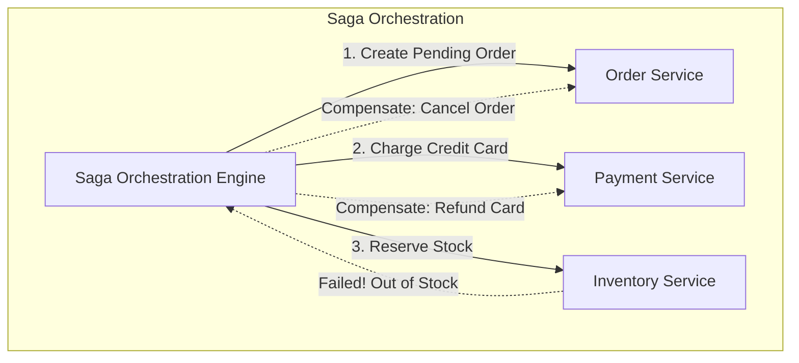

---

### 45. Compensating Transactions (Kompensatsiya tranzaksiyalari) qanday loyihalashtiriladi? / How to design Compensating Transactions?
> **UZ:** Kompensatsiya tranzaksiyasi — avval bajarilgan amalning mantiqiy teskarisi (masalan `ChargeCard()` uchun kompensatsiya `RefundCard()`, `ReserveSeat()` uchun `ReleaseSeat()`). Ular har doim muvaffaqiyatli bajariladigan (Idempotent and Retryable) qilib loyihalashtirilishi shart.  
> **EN:** Compensating transactions logically undo previous commits (e.g. Credit Card Refund for a failed order). They must be inherently idempotent and guaranteed to eventually succeed via retries.

---

### 46. Transactional Outbox Pattern va Change Data Capture (CDC) nima? / What is Transactional Outbox Pattern and CDC?
> **UZ:** Microservice o'z bazasiga ma'lumot yozishi va bir vaqtda Message Broker ga event yuborishi kerak bo'lganda, Dual-Write muammosi kelib chiqadi (baza yozilib xabar ketmay qolishi mumkin).  
> **Outbox Pattern:** Event to'g'ridan brokerga yuborilmaydi, balki o'sha DB tranzaksiyasining o'zida `OUTBOX` jadvaliga yoziladi.  
> **CDC (Debezium):** DB WAL (Write-Ahead Log) dagi o'zgarishlarni kuzatib, `OUTBOX` jadvalidagi yangi eventlarni Kafka ga avtomatik va kafolatlangan holda uzatadi.  
> **EN:** Outbox pattern avoids dual-write issues by saving domain entities and outbox events in a single local DB transaction. A CDC tool (Debezium) reads the DB transaction log to reliably push events to Kafka.

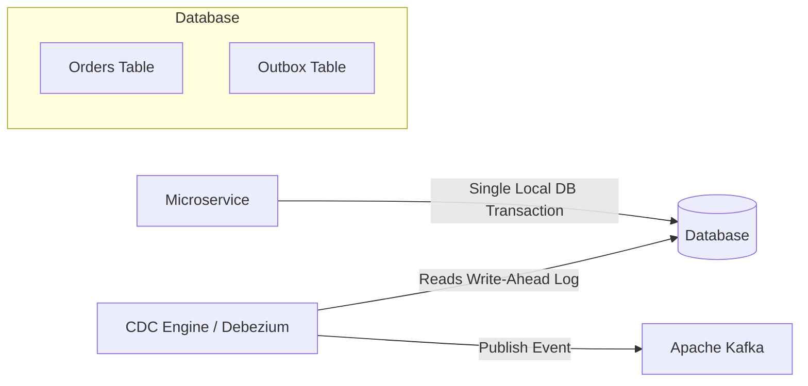

---

### 47. Circuit Breaker Pattern nima va uning holatlari (States)? / What is Circuit Breaker Pattern and its states?
> **UZ:** Circuit Breaker (Zanjir uzgich) — nosoz yoki sekin ishlayotgan tashqi servisga qayta-qayta so'rov yuborib server resurslarini to'ldirib yubormaslik uchun ishlatiladigan namuna.  
> **Holatlari:**  
> 1. **Closed (Yopiq):** Tizim normal ishlayapti, so'rovlar o'tayapti.  
> 2. **Open (Ochiq):** Xatoliklar foizi (Failure Rate Threshold) oshib ketdi. So'rovlar tashqi servisga yuborilmaydi, to'g'ridan-to'g meyorida `Fallback` javobi qaytariladi.  
> 3. **Half-Open (Yarim ochiq):** Taymer tugagach, servis sinov tariqasida bir nechta so'rovlarni o'tkazib ko'radi. Agar ular muvaffaqiyatli bo'lsa, `Closed` holatga qaytadi, aks holda yana `Open` bo'ladi.  
> **EN:** Circuit Breakers prevent cascading failures by stopping calls to failing dependencies. States: Closed (normal execution), Open (failing, fast-reject requests), Half-Open (trial execution to test recovery).

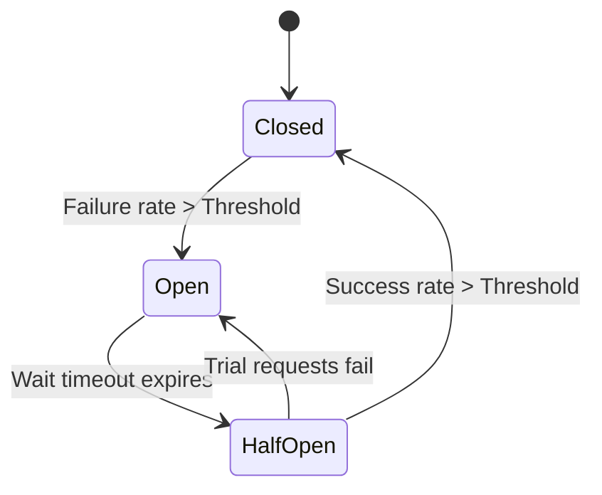

---

### 48. Resilience4j yordamida Circuit Breaker ni amalga oshirish namunasi? / Implementing Circuit Breaker using Resilience4j example?
> **UZ:** Java/Spring Boot ilovasida Resilience4j annotation va konfiguratsiya orqali boshqariladi.  
> **EN:** Resilience4j provides annotations and fallback functions for graceful service degradation.

```java
// Spring Boot Service with Resilience4j
@Service
public class PaymentGatewayService {

    @CircuitBreaker(name = "paymentService", fallbackMethod = "paymentFallback")
    public String processPayment(PaymentRequest request) {
        // Call External Payment Provider API
        return restTemplate.postForObject("https://api.stripe.com/v1/charges", request, String.class);
    }

    // Fallback logic executed when Circuit is OPEN or Exception occurs
    public String paymentFallback(PaymentRequest request, Throwable t) {
        log.error("Payment Gateway unreachable. Executing fallback", t);
        return "{\"status\": \"PENDING\", \"message\": \"Payment queued for offline processing\"}";
    }
}
```

---

### 49. Bulkhead Pattern va TimeLimiter Pattern nima? / What are Bulkhead and TimeLimiter Patterns?
> **UZ:**  
> - **Bulkhead Pattern:** Kema bo'linmalari kabi, ilovadagi resurslarni (Thread pool yoki Semaphore) har bir servis uchun alohida ajratish. Bitta sekin servis barcha worker threadlarni band qilib qo'yishiga yo meyor qo'ymaydi.  
> - **TimeLimiter Pattern:** So'rov bajarilishiga maksimal vaqt (Timeout) belgilaydi. Vaqt tugasa, ulanish uziladi va resurs bo meyoratiladi.  
> **EN:** Bulkhead isolates execution thread pools per dependency so one slow service cannot starve global app threads. TimeLimiter enforces strict execution timeouts on async remote calls.

---

### 50. Service Discovery Pattern nima (Client-side vs Server-side)? / What is Service Discovery (Client-side vs Server-side)?
> **UZ:** Dynamic cloud/K8s muhitida servis IP manzillari va portlari doim o'zgarib turadi. **Service Registry** (Consul, Eureka) barcha servislarning IP manzillarini ro meyorxatga oladi.  
> - **Client-side Discovery:** Client (masalan, API Gateway) Service Registry dan servislarning barcha IP manzillarini oladi va o'zi load balancing (Ribbon/LoadBalancer) qilib so'rov yuboradi.  
> - **Server-side Discovery:** Client so'rovni Router/Load Balancer ga yuboradi. Router Service Registry bilan bog'lanib, so'rovni tegishli servis IP sig ga yo meyornaltiradi (Kubernetes ClusterIP/DNS).  
> **EN:** Service Discovery dynamically registers and tracks microservice instances. Client-side discovery lets the client query the registry and load balance locally; Server-side discovery routes requests through a proxy router that handles registry resolution.

---

### 51. Consul vs Netflix Eureka vs Kubernetes CoreDNS taqqoslamasi? / Consul vs Netflix Eureka vs Kubernetes CoreDNS?
> **UZ:**  
> - **Netflix Eureka:** Faqat Java/Spring Cloud ekotizimida mashhur, HTTP REST-based service registry.  
> - **HashiCorp Consul:** Multi-datacenter, Health Checking, KV Store va Service Mesh (gRPC/HTTP) xususiyatlariga ega.  
> - **Kubernetes CoreDNS:** K8s-native yechim. Pod va Servislar uchun avtomatik ichki DNS yozuvlarini yaratadi (`my-service.default.svc.cluster.local`).  
> **EN:** Eureka is Spring-centric; Consul offers multi-datacenter capabilities with integrated KV and health checks; Kubernetes CoreDNS automatically maps internal service names to dynamic ClusterIPs natively.

---

### 52. Service Heartbeats va Health Checking mexanizmlari? / Service Heartbeats and Health Checking Mechanics?
> **UZ:** Servislar o'zlarining tirikligini ko'rsatish uchun Service Registry ga har N soniyada **Heartbeat** signalini yuboradi. Registry 3 xil tekshiruv o meytkazishi mumkin:  
> 1. **Liveness Probe:** Servis ishlayaptimi? (Ishlamasa container restart qilinadi).  
> 2. **Readiness Probe:** Servis trafik qabul qilishga tayyormi? (DB ga ulandimi? Tayyor bo'lmasa trafik yo'naltirilmaydi).  
> 3. **Startup Probe:** Ilova to meyorliq ishga tushdimi?  
> **EN:** Services periodically transmit Heartbeats to the registry. Health probes include Liveness (is container alive?), Readiness (is app ready to serve traffic?), and Startup probes.

---

### 53. Microservices da Read/Write Splitting va Database Connection routing? / Read/Write Splitting & DB routing in Microservices?
> **UZ:** Yozish so'rovlarini Primary (Master) bazaga, o'qish so'rovlarini esa Read Replicas larga yo meyornaltirish. Buni dasturiy kod darajasida (masalan, Spring `@Transactional(readOnly = true)` orqali Read Data Source ga ulash) yoki DB Proxy (PgBouncer, ProxySQL, AWS Aurora Endpoint) orqali bajarish mumkin.  
> **EN:** Directing write queries to Primary nodes and read queries to Replicas can be handled in code via transaction annotations or via transparent database proxies (ProxySQL, PgBouncer).

---

### 54. Blue-Green Deployment va Canary Deployment strategiyalari? / Blue-Green Deployment vs Canary Deployment strategies?
> **UZ:**  
> - **Blue-Green Deployment:** Ikkita bir xil muhit yaratiladi (Blue = eski versiya, Green = yangi versiya). Green to meyorliq sinovdan o'tgach, Load Balancer orqali 100% trafik Green ga o'tkaziladi. Instant rollback qilish juda oson.  
> - **Canary Deployment:** Yangi versiya (Canary) kichik qism serverlarga deploy qilinadi. Trafikning 5-10% qismi yangi versiyaga yo'naltiriladi. Xatoliklar bo'lmasa, sekin-asta 100% ga oshiriladi.  
> **EN:** Blue-Green deploys to a parallel environment and switches 100% of traffic instantly. Canary routes a small percentage (e.g. 5%) of live users to the new version to validate metrics before a full rollout.

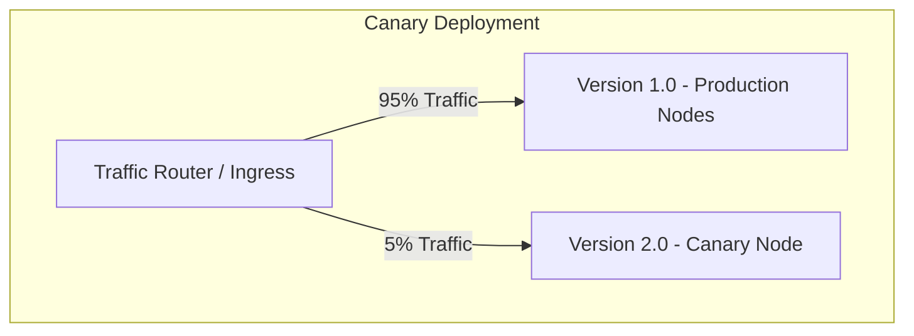

---

### 55. Microservice Observability: Distributed Tracing va Prometheus/Grafana? / Microservice Observability: Distributed Tracing & Metrics?
> **UZ:** Distributed Observability 3 ta ustunga tayanadi (The 3 Pillars):  
> 1. **Metrics:** Tizim ko'rsatkichlari (CPU, Memory, Request Rate, Latency, Error Rate). Prometheus yig'adi, Grafana vizualizatsiya qiladi.  
> 2. **Logs:** Markazlashtirilgan loglar (ELK Stack: Elasticsearch, Logstash, Kibana yoki Fluentd/Loki).  
> 3. **Distributed Tracing:** Microservices bo'ylab so'rov zanjirini kuzatish. Har bir kiruvchi so'rovga `Trace-ID` va har bir servis operatsiyasiga `Span-ID` beriladi (OpenTelemetry, Jaeger, Zipkin).  
> **EN:** Observability relies on Metrics (Prometheus/Grafana for numerical rates), Centralized Logging (ELK/Loki for events), and Distributed Tracing (Jaeger/OpenTelemetry with Trace-IDs to follow requests across microservices).

---

## 🔴 3. Ilg'or daraja / Advanced Level (56–80)

---

### 56. Event-Driven Architecture (EDA) nima va Events vs Commands farqi? / What is Event-Driven Architecture: Events vs Commands?
> **UZ:** EDA — ilovalar o'rtasidagi muloqot asinxron **Event (Hodisa)** larni yaratish, tarqatish va qabul qilish orqali amalga oshiriladigan arxitektura.  
> - **Command:** Kelajakda bajarilishi shart bo'lgan buyruq ("CreateOrder", "SendEmail"). Bitta aniq ijrochiga yuboriladi va javob kutilishi mumkin.  
> - **Event:** O'tmishda sodir bo'lib o'tgan inkor etib bo meyorlmas haqiqat ("OrderCreated", "PaymentFailed"). Qiziqqan istalgan subscriber tinglashi mumkin.  
> **EN:** EDA decouples systems via event notifications. Commands dictate action requests to a specific recipient ("ProcessPayment"); Events state immutable facts that occurred in the past ("PaymentProcessed") broadcast to optional subscribers.

---

### 57. CQRS (Command Query Responsibility Segregation) Pattern nima? / What is the CQRS Pattern?
> **UZ:** CQRS — ma'lumotlarni o'zgartirish (Write/Command) va ma'lumotlarni o'qish (Read/Query) modellarini va bazalarini alohida-alohida ajratish arxitektura namunasi.  
> **Nima uchun kerak?** O'qish so'rovlari (Complex JOINs, Search) va Yozish so'rovlari (High Write throughput, Domain Validation) bir-birining unumdorligiga halaqit bermasligi uchun. Read DB (masalan Elasticsearch) va Write DB (PostgreSQL) Eventlar orqali asinxron sinxronlashtiriladi (Eventual Consistency).  
> **EN:** CQRS separates read and write operations into distinct data models and databases. Writes update a normalized Write Store (PostgreSQL), which emits events to update an optimized Read Store (Elasticsearch).

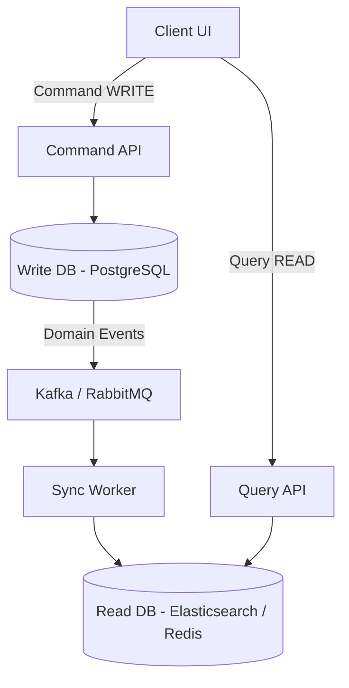

---

### 58. Event Sourcing Pattern nima va Event Store qanday ishlaydi? / What is Event Sourcing Pattern and Event Store?
> **UZ:** Event Sourcing — ob'ektning joriy holatini (State) saqlash o'rniga, uning ustida sodir bo'lgan barcha **voqealar (Events)** ketma-ketligini append-only log shaklida saqlash. Joriy holat voqealarni boshidan oxirigacha qayta ijro etish (Replay) orqali hosil qilinadi.  
> **Afzalliklari:** Mukammal Audit Log, vaqt bo'yicha istalgan nuqtaga qaytish (Time Travel Debugging).  
> **Snapshotting:** Eventlar soni milliondan oshganda o'qishni tezlashtirish uchun har N ta eventdan keyin ob'ektning Snapshot nusxasi olinadi.  
> **EN:** Event Sourcing persists state changes as an immutable sequence of events rather than overwriting current record columns. Current state is reconstructed by replaying events. Snapshots optimize replay speed.

---

### 59. CQRS va Event Sourcing arxitekturasini birga qo'llash? / Combining CQRS and Event Sourcing?
> **UZ:** Event Sourcing write-side uchun ideal **Event Store** vazifasini o'taydi. Yozish bajarilganda faqat event append qilinadi. CQRS esa ushbu eventlarni o'qib, turli o'qish modellarini (Projections) yaratadi va Read Database lardagi jadvallarni to meyorldiradi.  
> **EN:** Event Sourcing acts as the append-only write engine, while CQRS projects those raw immutable events into specialized read-optimized databases for low-latency querying.

---

### 60. Eventual Consistency va Vector Clocks nima? / What is Eventual Consistency and Vector Clocks?
> **UZ:**  
> - **Eventual Consistency:** Taqsimlangan tizimda barcha tugunlarga yangi ma'lumot darhol yetib bormasligi mumkin, lekin muayyan vaqt o meytgach (agar yangi update bo'lmasa), barcha tugunlar bir xil va to meyorg'ri ma'lumotga ega bo'lishi kafolatlanadi.  
> - **Vector Clocks:** Taqsimlangan tizimda markaziy soat (Central Clock) bo'lmaganda, turli serverlardagi hodisalarning sababiy tartibini (Causal Ordering) va mantiqiy vaqtini aniqlash hamda ma'lumotlar ziddiyatini (Conflict Detection) topish uchun ishlatiladigan algoritm.  
> **EN:** Eventual consistency guarantees node data uniformity given enough time. Vector clocks track causal relationships of events across nodes without relying on synchronized physical wall-clock time.

---

### 61. Consistent Hashing algoritmi va Hash Ring arxitekturasi? / What is Consistent Hashing and the Hash Ring concept?
> **UZ:** Standart `hash(key) % N` formula bo'yicha serverlar soni $N$ o'zgarganda (server qo'shilganda yoki o meychganda), deyarli barcha kalitlar (99%) boshqa serverlarga ko'chib o meytadi va kesh yo'qoladi (Massive Cache Miss).  
> **Consistent Hashing:** Kalitlar ham, serverlar ham 0 dan $2^{32}-1$ gacha bo'lgan doiraviy **Hash Ring** ga joylashtiriladi. Kalit o'zidan keyin soat mili bo'yicha birinchi uchragan serverga joylashadi. Server qo'shilganda yoki o'chirilganda faqat $K/N$ ta kalitlar ko'chadi ($K$ = kalitlar soni).  
> **EN:** Consistent Hashing maps both keys and servers to a virtual $2^{32}-1$ Hash Ring. When nodes join or leave, only $1/N$ keys need re-mapping, eliminating cache invalidation avalanches.

```mermaid
graph TD
    subgraph Hash Ring (0 to 2^32-1)
        ServerA[Server A] -->|Clockwise| Key1[Key 1]
        Key1 --> ServerB[Server B]
        ServerB --> Key2[Key 2]
        Key2 --> ServerC[Server C]
        ServerC --> ServerA
    end
```

---

### 62. Consistent Hashing da Virtual Nodes (V-Nodes) nima uchun kerak? / Why are Virtual Nodes (V-Nodes) essential in Consistent Hashing?
> **UZ:** Oddiy Hash Ring da serverlar halqada teng taqsimlanmasligi (Hotspots va Data Skew) mumkin (bitta serverga ko'p kalit tushib qoladi).  
> **Virtual Nodes:** Har bir jismoniy server halqada 100-250 ta unikal xaritalangan "Virtual Tugunlar" (masalan `ServerA-1`, `ServerA-2`) sifatida joylashtiriladi. Bu ma'lumotlarning barcha serverlar bo'ylab mukammal va teng taqsimlanishini ta'minlaydi.  
> **EN:** Physical servers may unevenly distribute along the ring. Virtual Nodes assign multiple ring tokens per physical node, achieving uniform load distribution and avoiding memory hotspots.

---

### 63. Cache Strategy: Cache-Aside (Lazy Loading) Pattern? / Cache Strategy: Cache-Aside (Lazy Loading)?
> **UZ:** Ilova ma'lumotni avval Keshdan qidiradi:  
> 1. **Cache Hit:** Ma'lumot keshda bor, darhol qaytariladi.  
> 2. **Cache Miss:** Ma'lumot keshda yo'q, DB dan o'qiladi, keshga yozib qo'yiladi va clientga qaytariladi.  
> **Afzalligi:** Faqat so meytralgan ma ma'lumotlar keshlanadi, kesh to'lib ketmaydi.  
> **Kamchiligi:** Birinchi marta o'qishda kechikish (Latency penalty) va DB va Kesh o'rtasida nomuvofiqlik xavfi.  
> **EN:** Application queries cache first. On miss, it reads from DB, updates cache lazily, and returns data. Keeps cache size lean but causes initial latency penalty on cache misses.

```python
# Cache-Aside Implementation in Python
def get_user_profile(user_id: str):
    cache_key = f"user:{user_id}"
    # 1. Try reading from Redis Cache
    cached_data = redis_client.get(cache_key)
    if cached_data:
        return json.loads(cached_data) # Cache Hit
    
    # 2. Cache Miss: Read from Primary DB
    user = db.query("SELECT * FROM users WHERE id = %s", (user_id,))
    if user:
        # 3. Write back to Redis with TTL
        redis_client.setex(cache_key, 3600, json.dumps(user))
    return user
```

---

### 64. Cache Strategy: Write-Through va Write-Around Caching Patterns? / Write-Through vs Write-Around Caching Patterns?
> **UZ:**  
> - **Write-Through:** Ilova ma'lumotni keshga yozadi. Kesh ushbu tranzaksiya doirasida ma'lumotni sinxron ravishda DB ga ham yozadi. Ma'lumot har doim keshda yangi va tayyor bo'ladi, lekin yozish kechikishi (write latency) oshadi.  
> - **Write-Around:** Ma'lumot to'g meyoridan DB ga yoziladi, kesh aylanib o'tiladi. Ma'lumot faqat kelgusida o'qilganda (Cache-Aside orqali) keshga tushadi. Yozish tez, lekin tez-tez o'qiladigan ma'lumotlar uchun birinchi o'qish sekin.  
> **EN:** Write-Through updates cache and database synchronously in one flow (consistent, but higher write latency). Write-Around bypasses the cache on writes, letting subsequent reads load the cache on-demand.

---

### 65. Cache Strategy: Write-Back (Write-Behind) Caching Pattern? / Write-Back (Write-Behind) Caching Pattern?
> **UZ:** Ilova ma'lumotni faqat keshga yozadi va darhol success javobini oladi. Kesh esa ma meymuriy vaqt oralig'ida (masalan har 5 sekundda) yoki fonda asinxron ravishda ma'lumotlarni DB ga to meyp bo'lib (batch) yozadi.  
> **Afzalligi:** Yozish tezligi jiddiy darajada yuqori (Extremely high write throughput).  
> **Kamchiligi:** Agar DB ga yozilmasdan oldin Redis server o'chib qolsa, ma'lumotlar yo'qolishi xavfi bor (Data loss risk).  
> **EN:** Writes are committed instantly to cache, and flushed asynchronously to the database in background batches. Delivers ultra-high write speed but risks data loss if the cache node crashes prior to flush.

---

### 66. Cache Eviction Policies (LRU, LFU, FIFO, ARC) farqlari? / Cache Eviction Policies: LRU, LFU, FIFO, ARC?
> **UZ:** Kesh xotirasi to'lganda qaysi kalitlarni o'chirish qoidasi:  
> - **LRU (Least Recently Used):** Eng uzoq vaqt ishlatilmagan kalitni o'chiradi.  
> - **LFU (Least Frequently Used):** Eng kam chastotada (ishlatilish soni kam) chaqirilgan kalitni o'chiradi.  
> - **FIFO (First In First Out):** Keshga birinchi bo'lib kirgan eski kalitni birinchi o'chiradi.  
> - **ARC (Adaptive Replacement Cache):** LRU va LFU ni o'zaro dinamik balanslaydi.  
> **EN:** LRU evicts items unused for the longest duration. LFU evicts items with the lowest access count frequency. FIFO evicts oldest inserted entries regardless of access frequency.

---

### 67. Cache Stampede (Thundering Herd) muammosi va uni hal etish? / What is Cache Stampede and how to prevent it?
> **UZ:** Juda ommabop kalitning (masalan, mashhur mahsulot sahifasi) TTL muddati tugagan sekundda, bir vaqtning o'zida minglab parallel so'rovlar keshda ma'lumot topolmay (Cache Miss), birgalikda to'g'ridan-to'g'ri DB ga so'rov yuboradi. Natijada DB chidamay yiqiladi.  
> **Yechimlar:**  
> 1. **Mutex Lock (Single Flight):** DB ga faqat birinchi so'rov o meytkaziladi va lock qo'yiladi, qolgan so'rovlar kutib turadi.  
> 2. **Probabilistic Early Expiration (XFetch algorithm):** TTL tugashidan sal oldin fon rejimida keshni avtomatik yangilab qo'yish.  
> **EN:** Cache Stampede occurs when a hot cache key expires, sending thousands of concurrent read queries directly to the DB. Solved using Distributed Mutex locks or Probabilistic Early Expiration algorithms.

---

### 68. Cache Invalidation, Cache Penetration, Cache Breakdown, Cache Avalanche? / Cache Penetration vs Breakdown vs Avalanche?
> **UZ:**  
> - **Cache Penetration:** DB da umuman yo'q bo'lgan id (masalan `id = -999`) bilan so'rovlar berib DB ni qiynash. *Yechim: Bloom Filter yoki NULL qiymatni keshga saqlash.*  
> - **Cache Breakdown:** Bitta ommabop hot-key expire bo'lganda DB ga yuk tushishi. *Yechim: Mutex lock.*  
> - **Cache Avalanche:** Bir vaqtning o'zida minglab kalitlarning TTL muddati birgalikda tugab qolishi. *Yechim: TTL ga tasodifiy sekundlar (Jitter / Random TTL) qo'shish.*  
> **EN:** Penetration queries non-existent keys (prevent with Bloom Filters). Breakdown hits one hot expired key (prevent with Mutex). Avalanche occurs when mass keys expire simultaneously (prevent with TTL Jitter).

---

### 69. CAP Teoremasi (Consistency, Availability, Partition Tolerance) chuqurlashtirilgan tahlili? / CAP Theorem Deep Dive?
> **UZ:** Taqsimlangan ma'lumotlar tizimida Tarmoq Uzilishi (Network Partition) sodir bo'lganda, tizim bir vaqtning o'zida faqat ikkitasini ta'minlay oladi:  
> - **Consistency (C):** Barcha tugunlar har qanday vaqtda eng so'nggi va bir xil ma'lumotni ko'radi.  
> - **Availability (A):** Har bir so'rovga har doim (hatto eski ma'lumot bo'lsa ham) muvaffaqiyatli javob qaytadi.  
> - **Partition Tolerance (P):** Tarmoq tugunlari o'rtasida aloqa uzilsa ham tizim ishlashda davom etadi.  
> **Taqsimlangan tizimda P majburiy!** Demak tanlov **CP** (masalan HBase, MongoDB, Redis Cluster) va **AP** (masalan Cassandra, DynamoDB) o'rtasida bo'ladi.  
> **EN:** Under network partitions (P), a distributed system must trade off strict Consistency (CP) for guaranteed Availability (AP). Real distributed networks must accept P, rendering CA theoretical only in single-node systems.

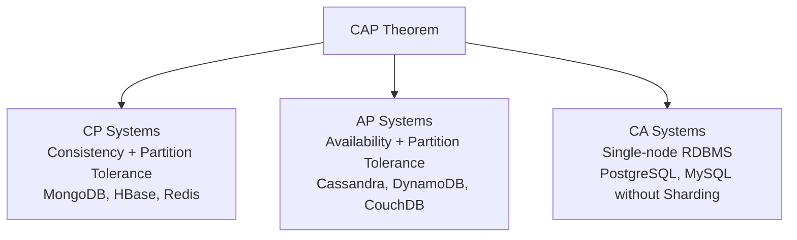

---

### 70. PACELC Teoremasi nima va u CAP dan nimasi bilan farq qiladi? / What is the PACELC Theorem?
> **UZ:** PACELC CAP teoremasini kengaytiradi va tarmoqda uzilish bo'lmagan **odatiy normal holat (Else)** uchun ham trade-off borligini ko'rsatadi:  
> - **If there is a Partition (P):** Trade-off between **Availability (A)** and **Consistency (C)**.  
> - **Else (E):** Trade-off between **Latency (L)** and **Consistency (C)**.  
> *Misol:* MongoDB -> **PC/EC** (normal holatda ham konsistentlik uchun kechikishni tanlaydi). Cassandra -> **PA/EL** (har doim past kechikish va yuqori availability ni tanlaydi).  
> **EN:** PACELC states: **If P**artition, choose between **A**vailability and **C**onsistency; **E**lse, choose between **L**atency and **C**onsistency. It evaluates latency trade-offs during normal fault-free execution.

---

### 71. Taqsimlangan Blokirovkalar (Distributed Locks) va Redis Redlock Algoritmi? / Distributed Locks and Redis Redlock Algorithm?
> **UZ:** Bir nechta microservices bitta resursni (masalan, ombordagi oxirgi mahsulot) bir vaqtda o'zgartirmasligi uchun taqsimlangan lock kerak.  
> **Redlock Algoritmi:** 5 ta mustaqil Redis master tugunlarida lock olish:  
> 1. Client joriy vaqtni (timestamp) oladi.  
> 2. 5 ta Redis tugunlarida birin-ketin bir xil key va unikal random token bilan `SET key value NX PX 10000` orqali lock olishga urinadi.  
> 3. Client kamida 3 ta (ko'pchilik / Quorum) tugunda lock ololsa va ketgan umumiy vaqt TTL dan kam bo'lsa, Lock muvaffaqiyatli deb hisoblanadi.  
> **EN:** Redlock acquires locks across $N$ (typically 5) independent Redis instances using random tokens and TTLs. A quorum (majority $> N/2$) must grant the lock within a timeout threshold to guarantee safety.

---

### 72. ZooKeeper / Etcd asosidagi Distributed Lock qanday ishlaydi? / How do ZooKeeper / Etcd Distributed Locks work?
> **UZ:** ZooKeeper **Ephemeral Sequential Nodes** va **Watchers** konseptsiyasiga tayanadi:  
> 1. Lock olmoqchi bo'lgan har bir client `/lock/request-` ostida ketma-ket ephemeral node yaratadi.  
> 2. Eng kichik raqamli node yaratgan client Lock manbasiga ega bo'ladi.  
> 3. Boshqa clientlar o'zidan bitta oldingi kichik raqamli node ga **Watcher** qo'yib kutadi. Oldingi node o meytchishi bilan keyingi client avtomatik Lock oladi (Thundering herd bo'lmaydi).  
> **EN:** ZooKeeper creates ephemeral sequential nodes. The client with the lowest sequence number holds the lock. Others watch the node immediately preceding theirs, preventing thundering herd lock contention.

---

### 73. Taqsimlangan Konsensus (Distributed Consensus) muammosi nima? / What is the Distributed Consensus Problem?
> **UZ:** Konsensus — taqsimlangan tarmoqdagi bir nechta mustaqil serverlarning muayyan ma'lumot yoki holat (masalan, kim lider server, tranzaksiya tasdiqlandimi) bo'yicha yagona to'g'ri to'xtamga (agreement) kelish jarayoni. Tarmoq kechikishi, paket yo'qolishi va serverlar avariyaga uchrashi sharoitida konsensusga erishish qiyin hisoblanadi.  
> **EN:** Distributed Consensus ensures that a cluster of independent nodes agree on a single data value or state transition despite server crashes, network partitions, and message delays.

---

### 74. Raft Konsensus Algoritmi qanday ishlaydi? / How does the Raft Consensus Algorithm work?
> **UZ:** Raft konsensusni tushunishni osonlashtirish uchun 3 ta kichik bosqichga bo'ladi:  
> 1. **Leader Election:** Tugunlar 3 holatda bo'ladi: *Leader*, *Follower*, *Candidate*. Leader har bir N ms da Heartbeat yuboradi. Heartbeat to'xtasa, Follower Candidate ga aylanadi, o meyzining Term raqamini oshiradi va ovoz yig'adi. Ko'pchilik (Quorum) ovozini olgan tugun **Leader** bo'ladi.  
> 2. **Log Replication:** Leader clientdan buyruqni oladi, o meyzining Log iga append qiladi va Follower larga `AppendEntries` RPC yuboradi. Ko'pchilik Follower yozgach, Leader commit qiladi.  
> 3. **Safety:** Faqat eng yangi va to'liq Log larga ega tugun Leader bo'lib saylanishi mumkin.  
> **EN:** Raft decomposes consensus into Leader Election, Log Replication, and Safety. Nodes elect a single Leader via majority quorum. The Leader acts as the authority for log entry replication.

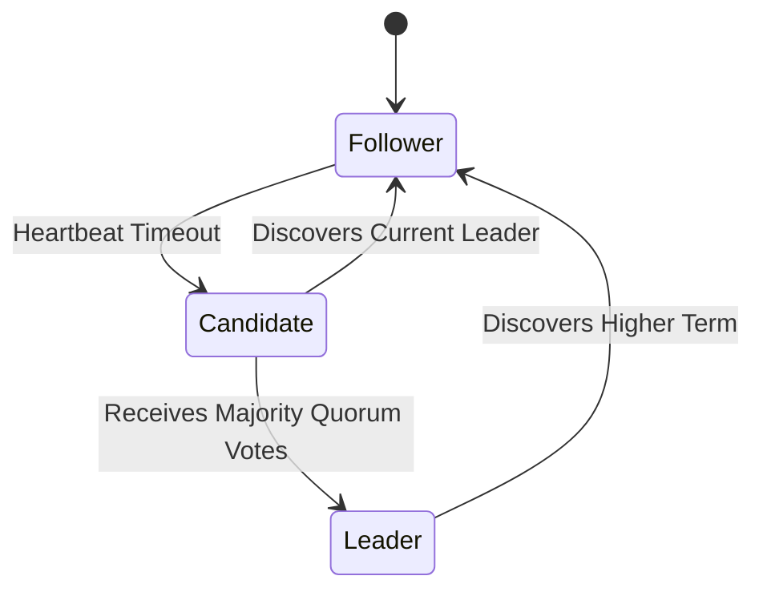

---

### 75. Paxos Konsensus Algoritmi nima (Basic Paxos vs Multi-Paxos)? / What is the Paxos Consensus Algorithm?
> **UZ:** Paxos — taqsimlangan tizimlarda konsensusning nazariy poydevori.  
> - **Basic Paxos:** Bitta qiymatni kelishib olish uchun 2 bosqichni bajaradi: **Prepare/Promise** (1-bosqich) va **Accept/Accepted** (2-bosqich). Roles: Proposer, Acceptor, Learner.  
> - **Multi-Paxos:** Har bir kelishuv uchun 2 bosqichli muloqot qilmaslik uchun barqaror **Leader Proposer** ni saylaydi va ketma-ket buyruqlar oqimini kamroq tarmoq muloqoti bilan commit qiladi.  
> **EN:** Basic Paxos reaches agreement on a single value through Prepare and Accept phases. Multi-Paxos optimizes this by electing a stable leader to stream multiple consensus decisions with reduced network rounds.

---

### 76. Split-Brain Muammosi va Quorum Voting Strategiyasi? / Split-Brain Problem and Quorum Voting Strategy?
> **UZ:**  
> - **Split-Brain:** Tarmoq uzilishi (Network Partition) tufayli bitta klaster ikki ajratilgan qismga bo'linib qolganda, ikkala qism ham o'zini tirik deb hisoblab, yangi alohida Leader saylab oladi. Natijada ma'lumotlar buziladi.  
> - **Quorum Voting Solution:** Har qanday qaror yoki Leader saylovi faqat va faqat **Quorum** ($Q = \lfloor N/2 \rfloor + 1$) sonidagi tugunlar mos kelsa qabul qilinadi. Klaster har doim toq sonli nodelardan (3, 5, 7) tashkil topishi kerak. Kichik qism Quorum yig'olmaydi va so'rov qabul qilmaydi.  
> **EN:** Split-Brain creates multiple active leaders during a network partition. Quorum Voting prevents this by enforcing that actions require a strict majority vote ($N/2 + 1$), allowing only the majority partition to operate.

---

### 77. Taqsimlangan Unikal ID Genratorlari (Twitter Snowflake & UUID v7)? / Distributed Unique ID Generators (Twitter Snowflake & UUID v7)?
> **UZ:** High-concurrency va Sharded DB lar uchun tartiblangan (K-sortable) unikal ID yaratish zarur.  
> - **Twitter Snowflake (64-bit Long):**  
>   - `1-bit`: Unused (0).  
>   - `41-bit`: Millisecond Timestamp (69 yilga etadi).  
>   - `10-bit`: Datacenter ID & Worker Node ID (1024 ta server).  
>   - `12-bit`: Sequence Number (bitta millisekundda 4096 ta ID).  
> - **UUID v7 (128-bit):** UNIX Timestamp (ms) birinchi 48-bit da joylashadi, bu esa DB indekslari uchun B-Tree do meyst bo'lgan tartiblanishni (time-ordered) ta'minlaydi.  
> **EN:** Snowflake generates 64-bit time-ordered integer IDs (Timestamp + Node ID + Sequence). UUID v7 embeds millisecond timestamps into 128-bit UUIDs to optimize B-Tree index insertion performance.

```
Snowflake ID Structure (64-bit):
0 - 0000000000 0000000000 0000000000 0000000000 0 - 00000 00000 - 000000000000
|   |---------------------------------------|   |-----------|   |----------|
Sign             41-bit Timestamp                 10-bit Node     12-bit Sequence
```

---

### 78. Distributed Tracing va Correlation ID lar o'tkazilishi? / Distributed Tracing & Correlation ID Propagation?
> **UZ:** Foydalanuvchining bitta so'rovi 10 lab microservices lardan o meytganda, muammoni tahlil qilish uchun har bir HTTP header da `X-Correlation-ID` yoki `traceparent` (W3C Standard: `00-4bf92f3577b34da6a3ce929d0e0e4736-00f067aa0ba902b7-01`) uzatiladi. Har bir microservice o meyzining logida ushbu Trace ID ni yozadi va keyingi servisga header orqali pasaytiradi.  
> **EN:** Distributed Tracing propagates standard HTTP headers (`traceparent` / `X-Correlation-ID`) across inter-service RPC call stacks to trace end-to-end user request flows in Jaeger/Zipkin.

---

### 79. API Versioning Strategiyalari (URL Path, Header, Query Parameter)? / API Versioning Strategies (URL Path, Header, Query Parameter)?
> **UZ:** API versiyalarini boshqarish usullari:  
> 1. **URL Path Versioning:** `/api/v1/users` va `/api/v2/users` (Eng ommabop, oson keshlanadi).  
> 2. **Custom Header Versioning:** `X-API-Version: 2` (URL toza qoladi).  
> 3. **Query Parameter:** `/api/users?version=2`.  
> 4. **Content Negotiation (Accept Header):** `Accept: application/vnd.mycompany.v2+json`.  
> **EN:** API Versioning options: URI Path (most common/cache-friendly), Custom Headers, Query Parameters, or Media Type Content Negotiation.

---

### 80. Zero Downtime Database Migration (Expand-Contract Pattern)? / Zero Downtime Database Migration (Expand-Contract Pattern)?
> **UZ:** Baza ustunini o meytganda yoki nomini o meyzgartirganda downtime bo meylmasligi uchun **Expand-Contract (Parallel Change)** bosqichlari bajariladi:  
> 1. **Expand:** Bazaga yangi ustun `new_email` qo'shiladi (eski `email` ham turadi).  
> 2. **Write Both:** App yangilanishi: yozish paytida ham `email`, ham `new_email` ga bir xil yoziladi.  
> 3. **Backfill:** Eski ma'lumotlar fon rejimida `new_email` ustuniga ko meychiriladi.  
> 4. **Read New:** App faqat `new_email` ustunini o'qiydigan qilinadi.  
> 5. **Contract:** Eski `email` ustuni va uni qo'llab-quvvatlovchi kodlar bazadan o'chiriladi.  
> **EN:** Expand-Contract pattern avoids downtime during schema changes: Expand (add new column), Write to both old and new, Backfill historical data, Read from new, Contract (deprecate and drop old column).

---

## ⚫ 4. Ekspert daraja: FAANG Tizimlari / Expert Level: Designing FAANG Systems (81–100)

---

### 81. System Design: URL Shortener (TinyURL) — Talablar va Hisob-kitoblar (Capacity Estimation)? / Design URL Shortener — Requirements & Capacity Estimation?
> **UZ:**  
> **Funktsional talablar:**  
> 1. Uzun URL berilganda unikal qisqa URL (masalan, `https://tiny.url/abc123X`) yaratish.  
> 2. Qisqa URL ga kirganda asl 301/302 HTTP redirect qilish.  
> **Nofunktsional talablar:** Yuqori Availability (99.99%), Juda past Read Latency (< 10ms), Idempotency.  
> **Hisob-kitoblar (Capacity Estimation):**  
> - Yozish (Write QPS): Kuniga 100 Million yangi URL -> $100M / 86400 \approx 1160$ write QPS.  
> - O'qish (Read QPS): Read:Write nisbati 10:1 -> $1160 \times 10 = 11,600$ read QPS.  
> - Saqlash (Storage): 1 ta URL yozuvi $\approx 500$ bytes. 10 yilda: $100M \times 365 \times 10 \times 500 B \approx 18.25$ Terabytes.  
> **EN:** URL Shortener functional specs include short link generation and 301/302 redirects. Non-functional goals: 99.99% Availability, low read latency. Capacity: 1.16K writes/sec, 11.6K reads/sec, ~18.25 TB 10-year storage.

---

### 82. System Design: URL Shortener — Yuqori darajadagi Arxitektura va Key Generation Service (KGS)? / Design URL Shortener — High-Level Architecture & KGS?
> **UZ:** Har safar so'rov kelganda DB dan hash urib qarash o'rniga alohida **Key Generation Service (KGS)** yaratiladi. KGS oldindan Base62 (a-z, A-Z, 0-9) formatida 7 belgili tayyor kalitlarni (`62^7 \approx 3.5 \text{ Trillion}$ unikal kalit) generatsiya qilib, xotirada saqlab turadi. Ilova so'rov kelganda KGS dan bitta ishlatilmagan kalitni oladi. KGS kalitlarni bir nechta app serverlarga taqsimlashda ziddiyat (collision) bo'lmasligi uchun xotira bloklarini (memory range) ajratadi.  
> **EN:** KGS pre-generates 7-character Base62 keys ($62^7 \approx 3.5$ Trillion unique strings) asynchronously, buffering them in memory to eliminate real-time hash collision checks.

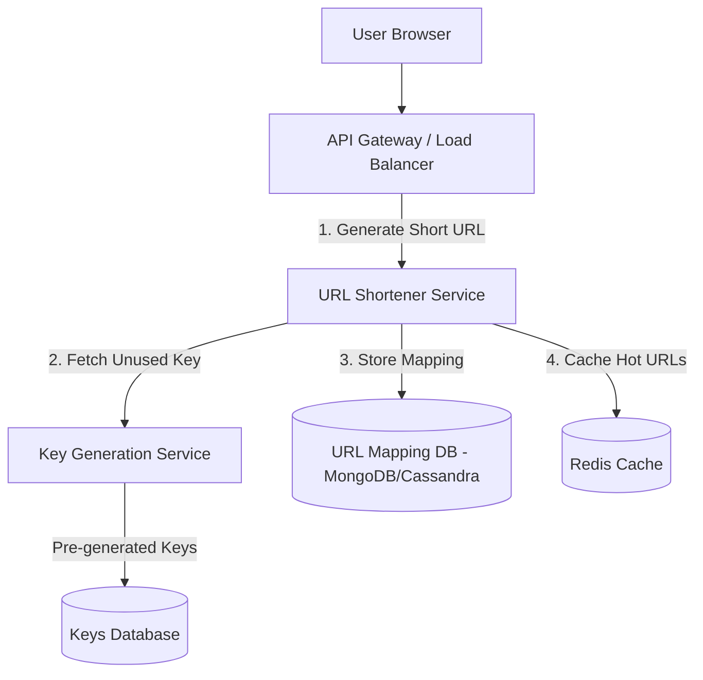

---

### 83. System Design: URL Shortener — Database Schema va Redis Cache strategiyasi? / Design URL Shortener — Database Schema & Caching Strategy?
> **UZ:** High read/write throughput uchun NoSQL Key-Value (MongoDB yoki DynamoDB) mos keladi.  
> **Schema:** `short_key` (PK, String), `original_url` (String), `user_id` (String), `created_at` (Timestamp), `expire_at` (Timestamp).  
> **Redirect HTTP Status:** `301 Moved Permanently` (Browser keshlaydi, server yuklanmaydi) vs `302 Found` (Browser har safar serverga uriladi, Analytics yig'ish uchun qulay).  
> **Redis Cache:** Pareto qoidasi (80/20 Rule) bo'yicha 20% eng aktiv linklar Redis keshida (Cache-Aside pattern) saqlanadi.  
> **EN:** Uses NoSQL KV store indexed on `short_key`. Redirect uses HTTP 301 for browser caching efficiency or HTTP 302 for tracking link click analytics. Redis caches the top 20% hot links.

---

### 84. System Design: Instant Messenger (WhatsApp / Telegram) — Talablar va Muloqot protokoli? / Design Instant Messenger — Requirements & Real-Time Protocol?
> **UZ:**  
> **Funktsional:** 1-to-1 va Group Chatlar, Online Status, Message Delivery Status (Sent, Delivered, Read), Media fayllar.  
> **Masshtab:** 500 Million kunlik aktiv foydalanuvchi (DAU). Bir vaqtda 50 Million faol ulanish (Concurrent Connections).  
> **Protokol:** HTTP doimiy ulanish uchun og'ir. Shuning uchun to'liq ikki tomonlama **WebSockets** (yoki TCP custom binary / MQTT) protokoli ishlatiladi.  
> **EN:** Supports 1-to-1/group chat, online presence, and delivery receipts for 500M DAU. Uses WebSockets (or MQTT) over TCP for persistent full-duplex client-server connections.

---

### 85. System Design: Instant Messenger — Connection Handler va Chat Gateway Arxitekturasi? / Design Instant Messenger — Stateful Connection Gateway?
> **UZ:** 50 Million active WebSocket ulanishlarini boshqarish uchun taqsimlangan **WebSocket Gateway Servers** klasteri o'rnatiladi.  
> **Session Service (Redis Cluster):** Qaysi `user_id` qaysi WebSocket Gateway Server ID siga ulanganligini saqlaydi (`user_100 -> Gateway_Node_42`).  
> Xabar kelganda, Chat Service Session Service dan qabul qiluvchining Gateway Serverini topadi va xabarni o'sha server orqali foydalanuvchiga uzatadi.  
> **EN:** WebSockets are stateful. A distributed Session Service (Redis) tracks the mapping of `user_id` to `Gateway_Node_ID` to route incoming messages directly to the target user's active socket host.

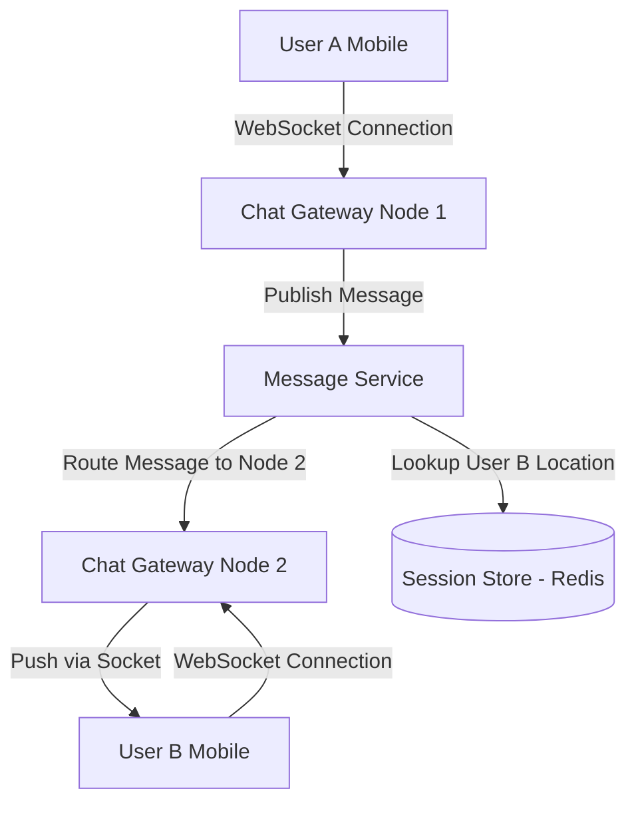

---

### 86. System Design: Instant Messenger — Message Storage (Cassandra) va Off-line Delivery? / Design Instant Messenger — Message Storage & Offline Delivery?
> **UZ:** Xabarlar yozish tezligi (Write-heavy) o'ta yuqori bo'lganligi sababli, kengayuvchan **Apache Cassandra / ScyllaDB** ishlatiladi.  
> **Schema:** `primary key ((chat_id), message_id)` — `chat_id` Partition key, `message_id` (Snowflake ID) Clustering key bo'ladi.  
> **Offline Delivery:** Qabul qiluvchi offline bo'lsa, xabar DB da saqlanadi. Foydalanuvchi tarmoqqa ulanganda (Connect Event), Chat Service DB dan o'qilmagan xabarlarni tortib (Pull) olib foydalanuvchiga uzatadi va statusni update qiladi.  
> **EN:** Uses Apache Cassandra due to massive append-only write speeds, partitioned by `chat_id` and clustered by time-sorted `message_id`. Unread messages buffer in DB until offline users reconnect.

---

### 87. System Design: Video Streaming Service (Netflix / YouTube) — System Architecture? / Design Video Streaming Service — System Architecture?
> **UZ:**  
> **Komponentlar:**  
> 1. **Client App:** Web, Mobile, Smart TV.  
> 2. **API Gateway:** Auth, Subscriptions, Metadata.  
> 3. **Video Ingestion & Transcoding Pipeline:** Faylni yuklash va qayta ishlash.  
> 4. **CDN (Content Delivery Network):** Videolarni yetkazib berish.  
> **EN:** Architecture splits into API Gateway (user metadata/auth), Video Ingestion Transcoding Pipeline (chunking/multi-bitrate conversion), and Global CDN distribution.

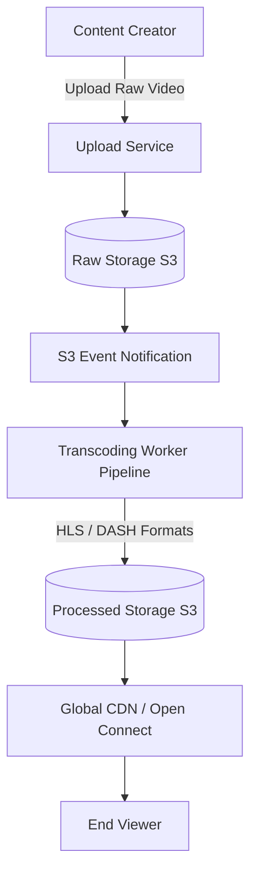

---

### 88. System Design: Video Streaming Service — Transcoding Pipeline va Adaptive Bitrate Streaming (HLS/DASH)? / Design Video Streaming — Transcoding & Adaptive Bitrate Streaming?
> **UZ:**  
> Raw video fayl (masalan 4K MP4, 20GB) to'g'ridan-to'g'ri foydalanuvchiga berilmaydi. Transcoding servisi videoni:  
> 1. Kichik 2-10 sekundlik **Chunks (Segmentlar)** ga bo'ladi.  
> 2. Har xil rezolyutsiyalarga (1080p, 720p, 480p, 360p) va kodeklarga (H.264, HEVC, AV1) transcode qiladi.  
> **Adaptive Bitrate Streaming (HLS / MPEG-DASH):** Client pleyeri foydalanuvchining internet tezligiga qarab dinamik ravishda mos rezolyutsiyadagi chunk fayllarini (`playlist.m3u8`) CDN dan yuklab oladi.  
> **EN:** Transcoders split raw videos into short chunks (2-10s) and encode them into multiple resolutions (1080p to 360p). Protocols like HLS/DASH dynamically adjust video quality to the viewer's network bandwidth.

---

### 89. System Design: Video Streaming Service — Video Metadata va Recommendation Engine? / Design Video Streaming Service — Video Metadata & Recommendation Engine?
> **UZ:**  
> - **Video Metadata DB:** Videoga oid sarlavha, tavsif, teglar, muallif, ko'rishlar soni va yoqtirishlar MySQL/PostgreSQL (Read Replicas bilan) yoki Cassandra da saqlanadi.  
> - **Recommendation Engine:** Foydalanuvchining ko'rish tarixi, to'xtatgan daqiqasi, qidiruvlari va bosgan tugmalari Kafka orqali Real-Time Data Pipeline (Apache Flink / Spark) ga yuboriladi va Machine Learning modellari orqali shaxsiylashtirilgan video tavsiyalar generatsiya qilinadi.  
> **EN:** Video metadata relies on replicated relational DBs. Real-time user interactions stream through Kafka into Big Data engines (Flink/Spark) to compute personalized ML-driven recommendations.

---

### 90. System Design: Ride-Sharing Service (Uber / Lyft) — Talablar va Arxitektura? / Design Ride-Sharing Service — Requirements & High-Level Architecture?
> **UZ:**  
> **Talablar:** Haydovchi joylashuvini real-time kuzatish (har 4 soniyada GPS o'zgartirish), Eng yaqin haydovchini topish (Ride Matching), Yo'l haqqini hisoblash (Surge Pricing), Marshrutni xaritada ko'rsatish.  
> **Masshtab:** 1 Million faol haydovchi. Har 4 soniyada location yuborilsa -> $1M / 4 = 250,000$ Location Updates/sec QPS.  
> **EN:** Tracks 1M active drivers sending GPS locations every 4s (250K write QPS). Requires geospatial indexing, dynamic ride matching, and real-time surge pricing engines.

---

### 91. System Design: Ride-Sharing Service — Geospatial Indexing (Geohash, QuadTree, Uber H3)? / Design Ride-Sharing Service — Geospatial Indexing?
> **UZ:** An'anaviy SQL `WHERE lat BETWEEN ... AND lng BETWEEN ...` so'rovi 250K QPS tezlikda ishlamaydi. Shuning uchun 2D koordinatalar 1D indeksga o'tkaziladi:  
> - **Geohash:** Yer yuzini kataklarga bo'ladi (Base32 string).  
> - **QuadTree:** Yer maydonini sig'imga qarab 4 ta rekursiv chorakka bo'luvchi daraxt ma'lumot tuzilmasi (In-memory saqlanadi).  
> - **Uber H3:** Yer sharini oltiburchak (Hexagonal) kataklar to'plamiga bo'luvchi fazoviy indeks.  
> **Location Store:** Haydovchilarning so'nggi ko'rinishi **Redis Geospatial** (`GEOADD`, `GEORADIUS`) da RAMda saqlanadi.  
> **EN:** Standard 2D SQL spatial queries fail at scale. Modern systems project 2D coordinates into 1D space using Geohash, QuadTrees, or Uber H3 hexagonal spatial grids cached in Redis Geospatial memory.

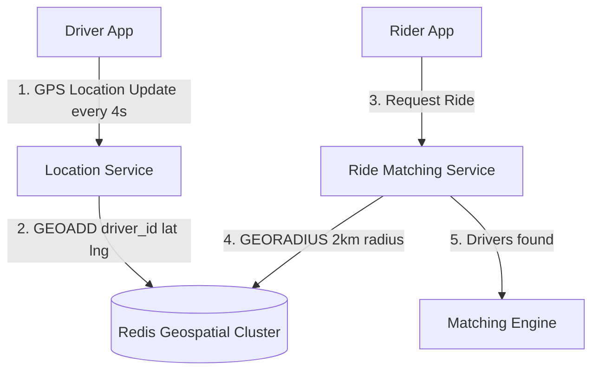

---

### 92. System Design: Ride-Sharing Service — Ride Matching va Surge Pricing Engine? / Design Ride-Sharing Service — Ride Matching & Surge Pricing Engine?
> **UZ:**  
> - **Matching Engine:** Talabgor yo'lovchi atrofidan (masalan 2km radiusda) H3/QuadTree yordamida bo'sh haydovchilar ro'yxatini oladi. ETA (Estimated Time of Arrival) va haydovchi reytingiga qarab eng mos haydovchiga taklif yuboradi.  
> - **Surge Pricing Engine:** Muayyan hududdagi talab (Rider Requests) va taklif (Available Drivers) nisbatini real-time hisoblab turadi. Agar talab taklifdan oshib ketsa, ko'paytiruvchi koeffitsient (masalan $1.5\times$, $2.0\times$) qo'llaniladi.  
> **EN:** The Matching Engine queries Redis for drivers within a 2km radius using geospatial indexing. Surge Pricing dynamically computes the local supply-demand ratio per H3 grid cell to apply price multipliers.

---

### 93. System Design: Distributed Search Engine (Elasticsearch Clone) — Web Crawler va Indexing Pipeline? / Design Search Engine — Web Crawler & Indexing Pipeline?
> **UZ:**  
> **Web Crawler (Spider):** Internetdagi sahifalarni rekursiv ravishda (Seed URLs) yuklab oladi (HTML). Duplicate sahifalarni **Bloom Filter** orqali chetlab o'tadi.  
> **HTML Parser & Content Extractor:** Matnni belgilardan tozalaydi, Tokenization (so'zlarga bo'lish), Stemming/Lemmatization (so'z o'zagini ajratish) va Stop-words (masalan 'the', 'is', 'va') larni o'chiradi.  
> **EN:** Web Crawlers fetch HTML pages avoiding duplicates via Bloom Filters. The parsing pipeline tokenizes text, removes stop words, and performs stemming to prepare terms for indexing.

---

### 94. System Design: Distributed Search Engine — Inverted Index (Teskari Indeks) Arxitekturasi? / Design Search Engine — Inverted Index Architecture?
> **UZ:** Qidiruv tizimining yuragi — **Inverted Index**. U so'zlardan hujjatlarga bo'lgan bog'liqlik xaritasini saqlaydi (An'anaviy DB dagi Hujjat -> So'zlar bo'lishiga teskari).  
> **Inverted Index strukturasi:**  
> So'z (Term) -> Hujjatlar ro'yxati (Posting List: `[DocID, Term Frequency, Positions]`).  
> **EN:** The Inverted Index maps individual words (Terms) to a sorted list of Document IDs (Posting Lists) containing that term, alongside term frequency and word positions for fast full-text matching.

```
Inverted Index Table Example:
Term        Posting List (Doc ID, Frequency)
-------------------------------------------------
"system"  -> [Doc 1, freq=3], [Doc 5, freq=1]
"design"  -> [Doc 1, freq=2], [Doc 2, freq=4], [Doc 5, freq=2]
"python"  -> [Doc 2, freq=1], [Doc 3, freq=5]
```

---

### 95. System Design: Distributed Search Engine — Relevance Scoring (BM25) va Sharding? / Design Search Engine — Relevance Scoring (BM25) & Sharding?
> **UZ:**  
> - **Relevance Scoring (BM25 / TF-IDF):** So'rov kelganda natijalarni saralash algoritmi.  
>   - **TF (Term Frequency):** So'zning shu hujjatda nechta marta uchragani.  
>   - **IDF (Inverse Document Frequency):** So'zning butun kolleksiyada qanchalik kamyobligini (unikal) ko'rsatadi.  
> - **Index Sharding:** Inverted Index gigant bo'lgani sababli, u bir nechta **Lucene Shards** larga bo'linadi. Coordinator Node so'rovni barcha shardlarga yuboradi (Scatter-Gather pattern) va top natijalarni birlashtirib qaytaradi.  
> **EN:** Evaluates search result relevance using BM25 scoring (combining Term Frequency and Inverse Document Frequency). Distributed shards use a Scatter-Gather query pattern to merge top-ranked document matches.

---

### 96. System Design: E-Commerce Checkout System (Flash Sale) — Talablar va Murakkabliklar? / Design E-Commerce Checkout System — Requirements & Challenges?
> **UZ:**  
> **Ssenariy:** 100 ta iPhone 15 o'ta arzon narxda sotuvga qo'yiladi (Flash Sale). Bitta sekundda 100,000 ta foydalanuvchi "Buy Now" tugmasini bosadi.  
> **Asosiy muammo:** Database Overbooking / Over-selling (Bazada boridan ko'proq sotib yuborish) va High Concurrency DB Lock contention.  
> **EN:** Flash sales experience 100K+ concurrent checkout requests for extremely limited inventory (e.g. 100 units). The primary challenge is preventing overselling without crushing DB performance.

---

### 97. System Design: E-Commerce Checkout System — Redis Lua Script bilan Inventory Reservation? / Design E-Commerce Checkout — Inventory Reservation with Redis Lua?
> **UZ:** So'rovlarni to'g'ridan RDBMS (PostgreSQL) bazaga yuborib bo'lmaydi.  
> **Strategiya:** Zaxira (Stock) **Redis** da saqlanadi. Tekshirish va zaxira qilish **Redis Lua Script** yordamida single-threaded atomic holda bajariladi:  
> 1. Lua skript Redis da `stock` ni tekshiradi: agar `stock >= count` bo'lsa, `stock = stock - count` qiladi va muvaffaqiyatli token qaytaradi.  
> 2. Stock tugasa, Lua skript darhol `0` qaytaradi va qolgan 99,900 so'rovlar DB ga bormasdan tezda rad etiladi (Fast Failure).  
> **EN:** Redis atomic Lua scripts handle real-time inventory deductions in memory. Only successful token holders proceed to DB order creation, while remaining requests fast-fail without hitting the database.

```lua
-- reserve_stock.lua
local item_key = KEYS[1]
local count = tonumber(ARGV[1])

local current_stock = tonumber(redis.call('GET', item_key) or "0")

if current_stock >= count then
    redis.call('DECRBY', item_key, count)
    return 1 -- Success: Stock Reserved
else
    return 0 -- Failed: Out of Stock
end
```

---

### 98. System Design: E-Commerce Checkout System — Payment Processing va Outbox/Saga pattern? / Design E-Commerce Checkout — Payment & Order Saga Workflow?
> **UZ:** Flash Sale buyurtma jarayoni:  
> 1. Foydalanuvchi Redis Lua dan stock reserved tokenini oladi.  
> 2. Order Service `PENDING` statusdagi buyurtma yaratadi va `Idempotency-Key` bilan Payment Gateway ga so'rov yuboradi.  
> 3. Payment muvaffaqiyatli bo'lsa, Order Status `PAID` ga o'tadi.  
> 4. Agar foydalanuvchi 15 minut ichida to'lov qilmasa (Payment Timeout), Saga Orchestrator avtomatik `CancelOrder` qiladi va Redis dagi zaxira stock ni ortga qaytaradi (`INCRBY stock count`).  
> **EN:** Token holders generate pending orders. If payment fails or times out (e.g. 15 min expiration window), Saga Orchestrators issue compensating transactions to release reserved Redis inventory back to the pool.

---

### 99. System Design: Distributed Rate Limiter & API Gateway for FAANG Scale (10M RPS)? / Design Distributed Rate Limiter for FAANG Scale (10M RPS)?
> **UZ:** 10 Million Requests Per Second (RPS) masshtabida bitta markaziy Redis klasteri bottleneck bo'lib qoladi.  
> **Yechim: Multi-Tier Distributed Rate Limiting:**  
> 1. **Tier 1 (Edge CDN / eBPF Kernel Filter):** DDoS va aniq IP blokirovkalar Linux Kernel darajasida (XDP / eBPF) yoki Cloudflare Edge da tashlab yuboriladi.  
> 2. **Tier 2 (Local In-Memory Batching Rate Limiter):** API Gateway instances o'z local RAM idagi Token Bucket ni ishlatadi. Ular har 1 soniyada Redis Cluster bilan sync qiladi (Batch Sync), ya'ni Redis ga 10M ta urilish o'rniga 1K ta batch update boradi.  
> **EN:** Scaling to 10M RPS requires multi-tier rate limiting: eBPF/XDP kernel drop filters at the edge, combined with in-memory token bucket batching inside API Gateway nodes to reduce Redis sync traffic by 1000x.

---

### 100. System Design Interview Blueprint — FAANG Intervyularini muvaffaqiyatli topshirish karkasi (4-Step Template)? / System Design Interview Blueprint (4-Step Template)?
> **UZ:** System Design intervyusini o'tkazishning oltin 4-bosqichli strukturasi:  
> 1. **Step 1: Clarify Requirements & Scope (3–5 min):** Functional & Non-Functional talablarni aniqlashtirish, masshtabni (DAU, QPS, Storage) hisoblash. Nimani loyihalash va nimani chetda qoldirishni intervyuer bilan kelishib olish.  
> 2. **Step 2: High-Level Architecture Design (10–15 min):** Tizimning blok-diagrammasini (Client, Gateway, Microservices, DB, Cache, Queue) chizish va asosiy data flow ni tushuntirish.  
> 3. **Step 3: Deep Dive into Core Components (15–20 min):** DB Schema loyihalash, Sharding key tanlash, API kontrakti, Maxsus algoritmlar (Consistent Hashing, Rate limiting, Lua, Geohash) va muammoli nuqtalarga sho'ng'ish.  
> 4. **Step 4: Bottlenecks & Resilience (5–10 min):** Single Point of Failure (SPOF) larni yo meypotish, Caching, Replication, Circuit Breaker, Monitoring va Scalability takliflarini berish.  
> **EN:** Crack FAANG System Design interviews using the 4-step framework: 1. Clarify Requirements & Scope (QPS/Storage); 2. Draft High-Level Architecture Diagram; 3. Deep Dive into DB Schema, APIs, & Algorithms; 4. Address Bottlenecks, Fault Tolerance, & Scalability trade-offs.

```mermaid
graph LR
    Step1[1. Clarify Requirements<br/>Scope & Capacity Estimation] --> Step2[2. High-Level Design<br/>Architecture & Data Flow]
    Step2 --> Step3[3. Deep Dive<br/>DB Schema, APIs & Core Algorithms]
    Step3 --> Step4[4. Bottlenecks & Resilience<br/>SPOF, Caching, Fault Tolerance]
```
